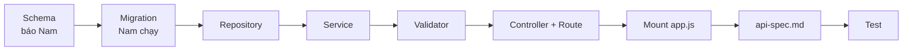

---
paths:
  - "BE_RStudy/**"
---

# Quy ước backend

Node v24, Express 5, Prisma 6.19, PostgreSQL (Supabase), CommonJS. Thư viện chính: `bcrypt` (không dùng `bcryptjs`), `jsonwebtoken`, `zod`, `multer`, `nodemailer`, `helmet`, `cors`, `morgan`.

Phân quyền và bảo vệ dữ liệu: `security.md`. Schema và migration: `database.md`. Nghiệp vụ: `business.md`.

## Phân tầng

19 module: auth, account, teacher, admin, category, course, resource, enrollment, coupon, invoice, review, comment, exam, submission, chatbot, recommendation, report, notification, learning. Mỗi module có đúng 5 file, phẳng theo tầng trong `src/`:

| Tầng       | File                                 | Được làm                                             |
| ---------- | ------------------------------------ | ---------------------------------------------------- |
| Route      | `routes/{module}Routes.js`           | Gắn URL, `validate`, middleware xác thực/phân quyền  |
| Controller | `controllers/{module}Controller.js`  | Nhận `req`/`res`, gọi service. Không có nghiệp vụ    |
| Service    | `services/{module}Service.js`        | Toàn bộ nghiệp vụ, kiểm tra quyền sở hữu, `AppError` |
| Repository | `repositories/{module}Repository.js` | Chỉ lệnh Prisma, không có nghiệp vụ                  |
| Validator  | `validators/{module}Validator.js`    | Zod schema cho body, query, params                   |

- Route → Controller → Service → Repository. Service được gọi service khác (ví dụ `notificationService`), không phụ thuộc vòng. Cần dùng chung thì tách ra `utils/`.
- Chỉ Repository `require("../config/database")`. Ngoại lệ duy nhất: Service mở `prisma.$transaction`.
- Mount ở `src/app.js` dạng số ít `/api/<module>`. Thêm đúng một dòng, không đụng dòng người khác.
- File camelCase + hậu tố tầng (`courseRepository.js`). Dùng `require`, không `import`. Tên biến/hàm tiếng Anh, thông báo tiếng Việt có dấu.

Tên module khác tên bảng:

| Module         | Bảng Prisma                                                                       |
| -------------- | --------------------------------------------------------------------------------- |
| account        | `Account` + `Student`                                                             |
| admin          | `Administrator`, `SystemFunction`, `PermissionAssignment`                         |
| coupon         | `DiscountCode`                                                                    |
| enrollment     | `CourseRegistration`                                                              |
| invoice        | `Invoice` + `SupportRequest` (yêu cầu hoàn tiền)                                  |
| submission     | `ExamAttempt`                                                                     |
| report         | `ViolationReport`                                                                 |
| chatbot        | `AiConversation`, `AiMessage`                                                     |
| recommendation | `CourseRecommendation`                                                            |
| learning       | `CourseLearning` (link lớp, link Drive, `showExams`) + `CourseSession` (lịch học) |

## Tiện ích có sẵn, không viết lại

| File                              | Dùng                                                                                                                       |
| --------------------------------- | -------------------------------------------------------------------------------------------------------------------------- |
| `utils/AppError.js`               | `throw new AppError("thông báo", status)`                                                                                  |
| `utils/response.js`               | `formatResponse(success, data, message)` → `{ success, message, data }`                                                    |
| `utils/pagination.js`             | `getPagination`, `buildPaginationMeta` (mặc định `page=1`, `limit=10`, tối đa 100)                                         |
| `utils/hash.js`, `utils/jwt.js`   | Băm mật khẩu, ký/kiểm tra token                                                                                            |
| `middlewares/validateMiddleware`  | `validate(schema)` kiểm tra body; `validate(schema, "params")` cho params                                                  |
| `middlewares/uploadMiddleware`    | `uploadAvatar`, `uploadCover`, `uploadResource`, `buildUploader({...})`                                                    |
| `middlewares/errorHandler`        | Ánh xạ Prisma: P2002→409, P2003→400, P2025→404. Lỗi 500 kèm `req.id` trong message và log                                  |
| `middlewares/rateLimitMiddleware` | `authIpLimiter`, `authCredentialLimiter`, `contentWriteLimiter` (sau `authenticate`, trước multer)                         |
| `middlewares/requestId`           | Gán `req.id` và header `X-Request-Id`, dùng trong log                                                                      |
| `config/ai.js`                    | `generateJson({ system, prompt })`, ném `AiError` khi lỗi hoặc hết giờ                                                     |
| `services/notificationService.js` | `notify`, `notifyStudent`, `notifyTeacher`, `notifyCourseTeacher`, `notifyCourseStudents`, `notifyAdmins(functionName, …)` |

## Response và lỗi

- Mọi API trả `res.status(code).json(formatResponse(true, data, "Thông báo"))`. Lỗi: `success: false`, `data: null`, `message` hiển thị được ở FE.
- Danh sách luôn phân trang: `data: { items, pagination: { total, page, limit, totalPages } }`, thứ tự ổn định (thường mới nhất trước).
- Service ném `AppError`, không tự gửi `res`. Express 5 tự chuyển lỗi async sang `errorHandler`, không cần `try/catch` hay `asyncHandler` trong controller.
- Mã HTTP: 400 dữ liệu sai/vi phạm nghiệp vụ, 401 chưa đăng nhập/token hết hạn, 403 không đủ quyền/tài khoản bị khóa, 404 không tìm thấy, 409 trùng hoặc xung đột trạng thái, 429 vượt tần suất, 500 lỗi hệ thống.
- Tiền (`Decimal`) trả JSON dạng chuỗi. Không bao giờ trả `passwordHash`.

## Validate

- Route gắn `validate(schema)` trước controller:

  ```js
  router.post(
    "/",
    authenticate,
    authorize("TEACHER"),
    validate(createCourseSchema),
    courseController.create,
  );
  ```

- Lỗi validate trả 400 dạng `"tênTrường: nội dung; tênTrường2: ..."`.
- Zod 4: dùng `z.strictObject(...)` (hoặc `.strict()`) để chặn trường không được gửi (ví dụ `usedCount`).
- Điều kiện schema không bao quát được (trạng thái, quyền sở hữu, ngày tháng) kiểm tra ở Service.

## Transaction

- Nghiệp vụ ghi nhiều bảng bọc trong `prisma.$transaction(async (tx) => { ... })`.
- Thông báo và email gửi **sau** khi transaction thành công, không đặt bên trong.

## Thông báo

- Sự kiện mới cần thông báo thì thêm hàm `notify*` trong `notificationService`, không tạo thông báo rải rác ở controller. Các hàm này tự nuốt lỗi.
- `payload = { type, title, body?, link? }`. `type` lấy trong `docs/enum.md`. `link` là đường dẫn FE có thật (ví dụ `/course/:id` lấy từ `comment.course.id`).

## Upload

| Loại             | Field    | Định dạng      | Tối đa | Thư mục             | Công khai |
| ---------------- | -------- | -------------- | ------ | ------------------- | --------- |
| Ảnh đại diện     | `avatar` | jpg, png, webp | 2MB    | `uploads/avatars`   | Có        |
| Ảnh bìa khóa học | `cover`  | jpg, png, webp | 3MB    | `uploads/covers`    | Có        |
| Tài liệu         | `file`   | pdf, docx      | 10MB   | `uploads/resources` | Có        |
| Minh chứng TT    | `proof`  | jpg, png, webp | 5MB    | `uploads/proofs`    | **Không** |

- Mọi upload đi qua `uploadMiddleware` / `buildUploader`. DB lưu đường dẫn tương đối.
- Thay ảnh (ví dụ ảnh đại diện) thì xóa tệp cũ.
- Thư mục tĩnh chỉ gồm `avatars`, `covers`, `resources` (khai báo trong `app.js`). Chuyển sang Cloudinary để giai đoạn cuối.

## AI

- `AI_PROVIDER=gemini` dùng `GEMINI_API_KEY`, `GEMINI_MODEL`. `AI_PROVIDER=openai` dùng mọi API tương thích OpenAI (mặc định Groq) với `AI_API_KEY`, `AI_BASE_URL`, `AI_MODEL`. Không đặt `AI_PROVIDER` thì tự chọn `gemini` khi chỉ có `GEMINI_API_KEY`. `AI_TIMEOUT_MS` mặc định 20000.
- Chỉ chatbot gọi AI (`generateJson` trong `recommendationService.recommend`). `GET /recommendation/me` không gọi AI.
- Mọi lời gọi LLM đi qua `config/ai.js`, có timeout và câu trả lời dự phòng khi lỗi.

## Thêm một module mới



1. Cần bảng/cột mới thì báo Nam (xem `database.md`).
2. Viết theo thứ tự Repository → Service → Validator → Controller → Route, rồi mount một dòng trong `app.js`.
3. Ghi mục API vào `docs/api-spec.md` (quyền, body, response, lỗi, ghi chú) và cập nhật bảng ở mục cuối (trạng thái tài liệu theo module). **API chưa có trong `api-spec.md` thì chưa tính là xong.**
4. Enum mới thì cập nhật `docs/enum.md` cùng lúc.
5. Viết test theo `testing.md`.

## Tài liệu tham khảo (đọc khi cần, không nạp sẵn)

- `BE_RStudy/docs/api-spec.md`: nguồn chuẩn endpoint cho cả FE và BE. Chưa có Swagger/OpenAPI.
- `BE_RStudy/docs/enum.md`: giá trị enum, trạng thái, loại thông báo.
