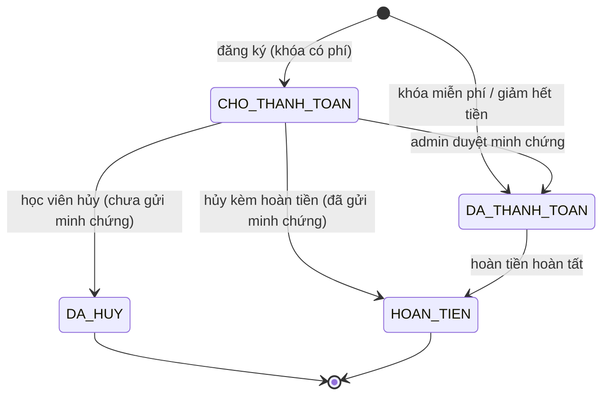

---
paths:
  - "BE_RStudy/src/services/**"
  - "BE_RStudy/src/validators/**"
  - "BE_RStudy/tests/**"
  - "FE_RStudy/src/pages/**"
---

# Quy tắc nghiệp vụ

Giá trị trạng thái và loại thông báo: `BE_RStudy/docs/enum.md`. Bối cảnh sản phẩm: `PRODUCT.md`.

## Tài khoản

- Đăng ký xong là dùng, không quản lý tuổi, không cần phụ huynh đồng ý. Phải xác minh email (`CHO_XAC_MINH`) mới đăng nhập được.
- Giáo viên tự đăng ký, chờ admin duyệt (`CHO_DUYET`). Admin duyệt lại được giáo viên đã `TU_CHOI`.
- Admin gồm Leader (toàn quyền, tạo bằng seed) và admin thường (chỉ chức năng được Leader cấp).
- Chỉ Leader quản lý admin khác: tạo, khóa/mở khóa, gán lại quyền. **Không xóa tài khoản admin**, chỉ khóa. Không khóa và không gán quyền cho Leader.

## Khóa học và không gian học

- Không có chương/bài học, không theo dõi tiến độ, không lưu video bài giảng.
- Danh mục bị ẩn thì khóa thuộc danh mục đó không hiển thị công khai (kể cả bình luận, đánh giá và gợi ý của chatbot).
- Khóa đã có đơn `CHO_THANH_TOAN` hoặc `DA_THANH_TOAN` thì giáo viên không đổi được học phí và thời gian học (`price`, `startDate`, `endDate`); tên, mô tả, ảnh bìa, danh mục vẫn sửa được.
- Admin từ chối khóa học (`CHO_DUYET` sang `BAN_NHAP`) phải nhập lý do (tối đa 500 ký tự). Lý do chỉ nằm trong thông báo gửi giáo viên, không lưu trên khóa học.
- Khách chưa đăng nhập xem được bình luận và đánh giá của khóa `DANG_MO`; chỉ học viên đã thanh toán và giáo viên phụ trách mới được viết.
- Tài liệu (`Resource`) là kho công khai theo danh mục, khách cũng xem được, không gắn với khóa học.
- Không gian học (`/api/learning`): `classUrl` (nút "Vào học"), `driveUrl` (thư mục Drive), lịch học (tiêu đề, giờ bắt đầu, giờ kết thúc, ghi chú), `showExams` (giáo viên bật/tắt mục bài thi; tắt thì học viên không thấy, không làm được đề).
- Chỉ học viên có đơn `DA_THANH_TOAN` xem được không gian học. Đã `HOAN_TIEN` thì mất quyền.

## Đăng ký và thanh toán

- Một học viên có thể có nhiều đơn cho cùng khóa (giữ đơn cũ) nhưng chỉ **một đơn còn hiệu lực** (`CHO_THANH_TOAN` hoặc `DA_THANH_TOAN`). Chặn trùng ở service.
- Đăng ký trùng: đơn cũ `CHO_THANH_TOAN` → trả lại để thanh toán tiếp; hóa đơn cũ bị từ chối → hủy đơn cũ, tạo đơn mới; đã `DA_THANH_TOAN` → 409.
- Đơn `DA_HUY` / `HOAN_TIEN` thì đăng ký lại bằng đơn mới, trừ khi còn yêu cầu hoàn tiền chưa xử lý cho khóa đó.
- Học viên tự hủy (`POST /enrollment/:id/cancel`) khi đơn `CHO_THANH_TOAN` và chưa gửi minh chứng (hoặc hóa đơn đã bị từ chối). Đã gửi minh chứng thì gửi yêu cầu hủy kèm hoàn tiền. Đã thanh toán thì chỉ rút qua luồng hoàn tiền.
- Tạo đơn, tạo hóa đơn và tăng `usedCount` mã giảm giá nằm trong **một transaction**. `usedCount` chỉ tăng khi `usedCount < usageLimit` (`updateMany` có điều kiện, `count === 0` thì 400). `studentId` của hóa đơn trùng học viên của đơn.
- Mã giảm giá: giảm số tiền **hoặc** phần trăm. Mỗi hóa đơn một mã, mỗi học viên dùng mỗi mã một lần, không giới hạn theo khóa.
- Khóa miễn phí (hoặc giảm hết tiền): đơn và hóa đơn tự `DA_THANH_TOAN`, không cần minh chứng, **không được hoàn tiền**.
- Thanh toán chuyển khoản thủ công: hệ thống tạo thông tin chuyển khoản + QR VietQR, học viên gửi ảnh minh chứng, admin duyệt hoặc từ chối kèm lý do.

## Hoàn tiền

- Yêu cầu được trong vòng **24 giờ** kể từ `paidAt` (tính lúc gửi). Học viên đã gửi minh chứng mà admin chưa duyệt cũng gửi được yêu cầu hủy kèm hoàn tiền.
- Mỗi đơn chỉ một yêu cầu chờ xử lý tại một thời điểm.
- Hai bước: admin **chấp thuận** (`CHO_HOAN_TIEN`), chuyển tiền thực tế, rồi **hoàn tất** (`DA_XU_LY`). Chỉ khi hoàn tất, đơn và hóa đơn mới thành `HOAN_TIEN`.
- Hoàn tiền không trả lại lượt mã giảm giá.

## Bình luận, đánh giá, báo cáo

- Chỉ học viên có đơn `DA_THANH_TOAN` được bình luận, đánh giá. Đã `HOAN_TIEN` thì không được nữa.
- Mỗi học viên đánh giá một lần cho mỗi khóa.

## Thi

- Thi được khi: đã thanh toán, đề `DANG_MO`, mục bài thi của khóa đang bật.
- `Exam.maxAttempts` 1 đến 10, mặc định 3. Bài `HUY` không tính lượt. Mỗi lần chỉ một bài `DANG_LAM`.
- Chấm điểm và kiểm tra thời gian ở server (cho trễ 10 giây). Hết giờ chưa nộp thì server tự nộp với đáp án đã lưu.
- Chỉ trắc nghiệm một đáp án đúng.

## AI và gợi ý

- Chatbot gợi ý khóa `DANG_MO` (trong ngân sách nếu học viên nêu), chỉ từ danh sách ứng viên có thật, kèm lý do. Lưu lịch sử hội thoại.
- Hạn mức chatbot mỗi học viên: 6 tin/phút, 50 tin/24 giờ, và mỗi lúc chỉ một tin đang chờ trả lời (tránh tốn chi phí AI).
- AI lỗi hoặc hết giờ: trả câu dự phòng, hướng học viên dùng tìm kiếm và bộ lọc. AI không tự đăng ký hay thanh toán.
- "Dành cho bạn" (`GET /recommendation/me`, không gọi AI): khóa `DANG_MO` thuộc danh mục đang hiển thị, cùng danh mục với khóa học viên đã đăng ký, thiếu thì bù khóa nhiều người đăng ký.

## Thông báo

- Tạo thông báo cho: việc mới chờ admin xử lý (giáo viên, khóa học, đề thi, thanh toán, báo cáo; gửi Leader và admin có quyền tương ứng), kết quả duyệt giáo viên/khóa học/đề thi, kết quả thanh toán và hoàn tiền, đề thi mới mở, lịch học mới hoặc đổi lịch, bình luận được trả lời, học viên nộp bài, kết quả xử lý báo cáo vi phạm (gửi người báo cáo, kèm kết quả hoặc lý do).
- Thông báo là phần phụ: tạo thông báo lỗi không được làm hỏng nghiệp vụ chính.

## Chưa chốt (không tự quyết)

- Truy cập khóa học có giới hạn thời gian không (hiện không giới hạn).
- Admin đầu tiên có bắt buộc đổi mật khẩu lần đầu không (hiện không).
- Chống gian lận khi thi ngoài việc chỉ mở một bài; thêm loại câu hỏi khác.
- Ngưỡng hiệu năng.
