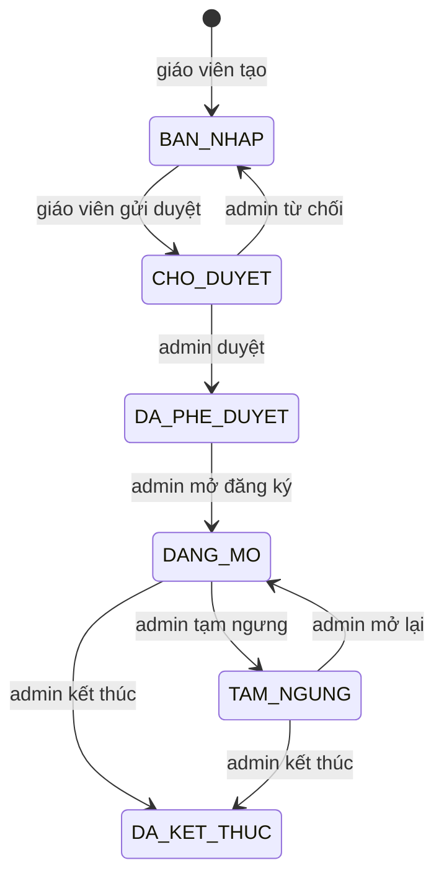
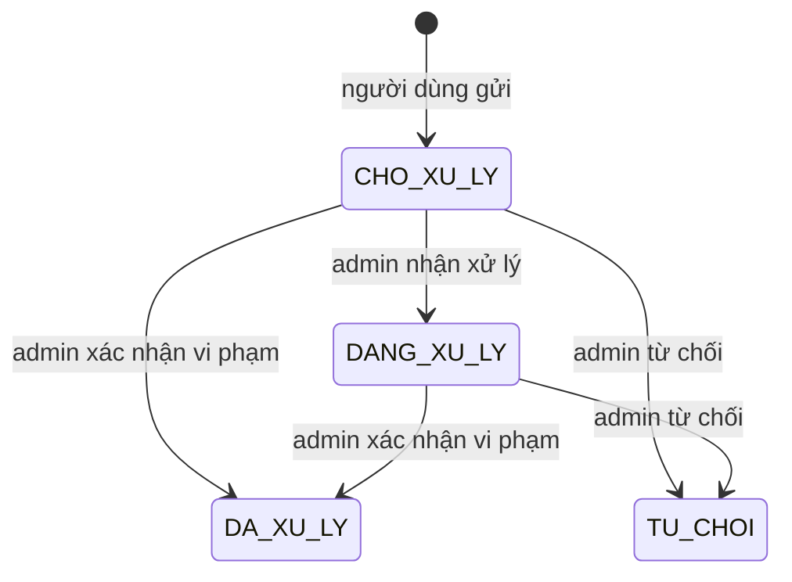

# API Spec RoadStudy

Base URL: `http://localhost:5000/api` (FE đặt trong `VITE_API_URL`). Đường dẫn file upload là đường dẫn tương đối, FE ghép với `VITE_ASSET_URL` (`http://localhost:5000`).

Trong file này, đường dẫn endpoint viết **không có tiền tố `/api`** (ví dụ `/auth/login` nghĩa là `POST http://localhost:5000/api/auth/login`).

Quy tắc nhóm: **API chưa có trong file này thì chưa tính là xong.** Người viết API điền mục của mình trước khi báo Done. FE thấy spec sai hoặc thiếu thì báo người viết BE sửa spec, không tự đoán.

## 1. Quy ước chung

### Định dạng response

Mọi API đều trả:

```json
{ "success": true, "message": "...", "data": ... }
```

Lỗi: `success: false`, `data: null`, `message` là nội dung hiển thị được.

### Mã HTTP

| Mã        | Nghĩa                                                                                                 |
| --------- | ----------------------------------------------------------------------------------------------------- |
| 200 / 201 | Thành công / tạo mới thành công                                                                       |
| 400       | Dữ liệu sai hoặc vi phạm nghiệp vụ. Lỗi validate có dạng `"tênTrường: nội dung lỗi; tênTrường2: ..."` |
| 401       | Chưa đăng nhập, token sai hoặc hết hạn                                                                |
| 403       | Không đủ quyền, hoặc tài khoản bị khóa / chưa xác minh                                                |
| 404       | Không tìm thấy (kể cả URL không tồn tại)                                                              |
| 409       | Trùng dữ liệu (ví dụ email đã dùng) hoặc xung đột trạng thái (ví dụ duyệt khóa không ở `CHO_DUYET`)   |
| 429       | Gửi quá nhanh hoặc vượt hạn mức (xem mục "Giới hạn tần suất")                                         |
| 500       | Lỗi hệ thống: `"Lỗi hệ thống, vui lòng thử lại sau (mã: <requestId>)"`                                |

### Xác thực

- API cần đăng nhập gửi header: `Authorization: Bearer <accessToken>`.
- Access token sống **15 phút**, refresh token sống **7 ngày**.
- Khi gặp 401 "Token không hợp lệ hoặc hết hạn": gọi `POST /auth/refresh`. Refresh thành công thì gọi lại request cũ. Refresh cũng 401 thì xóa token và chuyển về trang đăng nhập.
- Refresh token **xoay vòng**: mỗi lần refresh nhận cặp token mới, token cũ mất hiệu lực. FE phải lưu cặp mới.
- Nhiều request cùng lúc gặp 401: chỉ gọi /auth/refresh MỘT lần, các request còn lại chờ rồi gọi lại. Refresh token xoay vòng nên gọi hai lần cùng một token sẽ bị 401 ở lần hai.
- Dùng lại một refresh token đã bị thu hồi (quá 10 giây sau khi bị thu hồi) bị coi là nghi đánh cắp: mọi phiên của tài khoản bị thu hồi và phải đăng nhập lại. Trong 10 giây đầu chỉ trả 401 để hai tab refresh gần cùng lúc không bị đăng xuất; tab đến sau nên dùng cặp token tab kia vừa lưu.
- Không tự refresh khi chính /auth/login hoặc /auth/refresh trả 401 (tránh lặp vô hạn). Nhận biết theo URL, không theo nội dung message.
- Lỗi thường gặp ở mọi API cần đăng nhập:
  - 401 `Thiếu token xác thực`
  - 401 `Token không hợp lệ hoặc hết hạn`
  - 403 `Không đủ quyền truy cập` (sai vai trò)
- Lỗi thường gặp ở API quản trị (ghi "`ADMINISTRATOR` + `<QUYỀN>`"; Leader luôn qua kiểm tra quyền):
  - 403 `Tài khoản quản trị không hợp lệ hoặc đã bị khóa`
  - 403 `Bạn không có quyền thực hiện chức năng này` (thiếu quyền chức năng)
  - 403 `Chỉ Leader mới được thực hiện chức năng này` (API chỉ dành cho Leader)
- Lỗi validate tham số, query và body có dạng `"tênTrường: nội dung"`, nhiều lỗi nối bằng `"; "`. Lỗi kiểm tra trên cả body (ví dụ "cần ít nhất một trường") không gắn với trường nào nên chỉ có nội dung, không có tiền tố.

### Giới hạn tần suất

Vượt giới hạn trả **429** `Bạn thao tác quá nhanh, vui lòng thử lại sau ít phút` (header `RateLimit` cho biết thời gian còn lại). Bộ đếm lưu trong bộ nhớ server nên reset khi server khởi động lại.

| Phạm vi                                                                                                                        | Giới hạn                                     | Tính theo            |
| ------------------------------------------------------------------------------------------------------------------------------ | -------------------------------------------- | -------------------- |
| Mọi `/auth/*`                                                                                                                  | 60 lần/phút                                  | IP                   |
| `/auth/login`, `verify-email`, `resend-otp`, `forgot-password`, `reset-password`                                               | 10 lần/phút                                  | IP + email           |
| `POST` bình luận, trả lời, đánh giá, phản hồi đánh giá, báo cáo vi phạm, và mọi upload (avatar, ảnh bìa, tài liệu, minh chứng) | 10 lần/phút (dùng chung)                     | Tài khoản            |
| `POST /chatbot/messages`                                                                                                       | 6 tin/phút và 50 tin/24 giờ                  | Học viên             |
| OTP                                                                                                                            | Sai tối đa 5 lần mỗi mã; gửi lại sau 60 giây | Tài khoản + mục đích |

Khi chạy sau reverse proxy phải đặt `TRUST_PROXY` (xem `SETUP.md`) để giới hạn theo IP đúng.

Mọi upload được kiểm tra nội dung thật của file (JPEG, PNG, WebP, PDF, DOCX). File có đuôi hoặc `Content-Type` đúng nhưng nội dung sai bị từ chối: 400 `Nội dung tệp không đúng định dạng`.

### Vai trò

`STUDENT`, `TEACHER`, `ADMINISTRATOR`. Giá trị enum xem `docs/enum.md`.

### Kiểu dữ liệu

- Tiền (Decimal) trả về dạng **chuỗi**, ví dụ `"499000.00"`. FE tự định dạng VND.
- Thời gian là chuỗi ISO 8601, lưu giờ UTC. FE hiển thị theo giờ Việt Nam.
- Không bao giờ có `passwordHash` trong response.

### Phân trang (mọi API danh sách)

Query: `?page=1&limit=10` (mặc định page 1, limit 10, tối đa 100).

Response danh sách dùng dạng:

```json
{
  "success": true,
  "message": "",
  "data": {
    "items": [ ... ],
    "pagination": { "total": 42, "page": 1, "limit": 10, "totalPages": 5 }
  }
}
```

### Kiểm tra server và truy vết

- `GET /health` trả `{ "status": "ok" }`: tiến trình còn sống (nằm ngoài `/api`).
- `GET /health/ready` trả `{ "status": "ok" }` khi kết nối được database, ngược lại 503 `{ "status": "unavailable" }`. Docker dùng endpoint này làm healthcheck.
- Mọi response có header `X-Request-Id`. FE có thể gửi header này (chữ, số, `-`, `_`, tối đa 64 ký tự) để dùng mã của mình. Lỗi 500 kèm mã này trong `message` để báo lại cho nhóm tra log.

---

## 2. Auth (`/api/auth`) — Nam

Luồng đăng ký: `register` → nhận OTP qua email → `verify-email` → `login`.
Tài khoản mới có `status = CHO_XAC_MINH`, chưa đăng nhập được cho tới khi xác minh.
Mã OTP gồm 6 chữ số, hết hạn sau 10 phút. Khi server chưa cấu hình SMTP, OTP được in ra console server (dòng `[DEV MAIL]`).

### POST /auth/register

- Quyền: công khai
- Body học viên:

| Trường      | Kiểu        | Bắt buộc | Ghi chú                              |
| ----------- | ----------- | -------- | ------------------------------------ |
| role        | `"STUDENT"` | có       |                                      |
| fullName    | string      | có       | 1 đến 100 ký tự                      |
| email       | string      | có       | email hợp lệ, tối đa 254             |
| password    | string      | có       | tối thiểu 8 ký tự                    |
| phoneNumber | string      | không    | tối đa 15                            |
| dateOfBirth | string      | không    | ngày, ví dụ `"2003-05-10"`           |
| gender      | string      | không    | `NAM`, `NU`, `KHAC`, `KHONG_TIET_LO` |
| address     | string      | không    | tối đa 255                           |

- Body giáo viên:

| Trường                                 | Kiểu        | Bắt buộc | Ghi chú         |
| -------------------------------------- | ----------- | -------- | --------------- |
| role                                   | `"TEACHER"` | có       |                 |
| fullName, email, password, phoneNumber |             |          | như trên        |
| specialization                         | string      | có       | 1 đến 150 ký tự |
| biography                              | string      | có       |                 |
| teachingExperience                     | string      | có       |                 |

- 201: `data` là tài khoản vừa tạo (`id, fullName, email, phoneNumber, avatarUrl, role, status: "CHO_XAC_MINH", createdAt, student | teacher | administrator`)
- Message: `Đăng ký thành công, vui lòng kiểm tra email để xác minh`
- Lỗi: 400 sai dữ liệu | 409 `Email đã được sử dụng`
- Ghi chú: giáo viên mới có `approvalStatus = CHO_DUYET`. Nếu email OTP không tới, dùng `resend-otp`.

### POST /auth/verify-email

- Quyền: công khai
- Body: `{ "email": string, "code": string }` (`code` đúng 6 ký tự, không có khoảng trắng)
- 200: `data: null`, message `Xác minh email thành công`. Tài khoản chuyển sang `HOAT_DONG`.
- Lỗi: 400 `Mã xác thực không đúng hoặc đã hết hạn` (cũng trả khi email không tồn tại hoặc đã xác minh, để không lộ email nào đã đăng ký) | 400 `Mã xác thực không đúng` | 400 `Bạn đã nhập sai quá nhiều lần, vui lòng yêu cầu mã mới` | 429
- Ghi chú: mỗi mã OTP chỉ được nhập sai tối đa 5 lần, sau đó phải yêu cầu mã mới (`resend-otp`). Mã chỉ dùng được một lần.

### POST /auth/resend-otp

- Quyền: công khai
- Body: `{ "email": string, "purpose": "XAC_MINH_EMAIL" | "QUEN_MAT_KHAU" }`
- 200: `data: null`, message `Mã xác thực đã được gửi tới email` (hoặc `Nếu email tồn tại, mã xác thực đã được gửi` khi email không có trong hệ thống)
- Lỗi: 400 `Tài khoản đã được xác minh trước đó` (khi purpose là `XAC_MINH_EMAIL`) | 429 `Vui lòng đợi N giây trước khi yêu cầu mã mới` (chỉ khi purpose là `XAC_MINH_EMAIL`; với `QUEN_MAT_KHAU` yêu cầu gửi quá sớm vẫn trả 200 nhưng không gửi mã mới)
- Ghi chú: phải chờ 60 giây giữa hai lần gửi mã cho cùng một tài khoản và mục đích.

### POST /auth/login

- Quyền: công khai
- Body: `{ "email": string, "password": string }`
- 200: message `Đăng nhập thành công`

```json
{
  "accessToken": "...",
  "refreshToken": "...",
  "account": {
    "id": "",
    "fullName": "",
    "email": "",
    "phoneNumber": null,
    "avatarUrl": null,
    "role": "STUDENT",
    "status": "HOAT_DONG",
    "createdAt": ""
  }
}
```

- Lỗi: 401 `Email hoặc mật khẩu không đúng` | 403 `Tài khoản đã bị khóa` | 403 `Tài khoản chưa xác minh email, vui lòng kiểm tra email hoặc yêu cầu gửi lại mã` | 403 `Tài khoản giáo viên đang chờ quản trị viên duyệt` | 403 `Tài khoản giáo viên đã bị từ chối` | 429 (quá 10 lần/phút với cùng email)
- Ghi chú: `account` ở đây **không** có `student`/`teacher`/`administrator`. Cần hồ sơ đầy đủ thì gọi `GET /auth/me`. FE dùng `account.role` để chuyển trang: STUDENT về trang chủ, TEACHER vào `/teacher`, ADMINISTRATOR vào `/admin`. Giáo viên `CHO_DUYET` hoặc `TU_CHOI` **không đăng nhập được** (403), FE hiển thị nguyên message của BE.

### POST /auth/refresh

- Quyền: công khai
- Body: `{ "refreshToken": string }`
- 200: message `Làm mới token thành công`, `data: { "accessToken": "...", "refreshToken": "..." }`
- Lỗi: 401 `Refresh token không hợp lệ hoặc hết hạn` | 401 `Refresh token không hợp lệ hoặc đã bị thu hồi` | 401 `Phiên đăng nhập không hợp lệ, vui lòng đăng nhập lại` (token cũ bị dùng lại, mọi phiên bị thu hồi) | 403 `Tài khoản không khả dụng` | 403 `Tài khoản giáo viên đang chờ quản trị viên duyệt` | 403 `Tài khoản giáo viên đã bị từ chối`
- Ghi chú: token cũ bị thu hồi ngay, dùng lại sẽ 401. Giáo viên đang đăng nhập mà bị chuyển về chưa duyệt thì refresh trả 403.

### POST /auth/logout

- Quyền: đã đăng nhập (mọi vai trò)
- Header: `Authorization: Bearer <accessToken>`
- Body: `{ "refreshToken": string }`
- 200: `data: null`, message `Đăng xuất thành công`
- Ghi chú: refresh token bị thu hồi. Access token cũ vẫn dùng được cho tới khi hết hạn (tối đa 15 phút), FE chỉ cần xóa token ở máy.

### POST /auth/forgot-password

- Quyền: công khai
- Body: `{ "email": string }`
- 200: `data: null`, message `Nếu email tồn tại trong hệ thống, mã đặt lại mật khẩu đã được gửi`
- Ghi chú: luôn trả 200 dù email có tồn tại hay không, kể cả khi gọi lại trong vòng 60 giây (khi đó không gửi mã mới). Gửi OTP với mục đích `QUEN_MAT_KHAU`.

### POST /auth/reset-password

- Quyền: công khai
- Body: `{ "email": string, "code": string, "newPassword": string }` (`code` đúng 6 ký tự, `newPassword` tối thiểu 8)
- 200: `data: null`, message `Đặt lại mật khẩu thành công`
- Lỗi: 400 `Mã xác thực không đúng hoặc đã hết hạn` | 400 `Mã xác thực không đúng` | 400 `Bạn đã nhập sai quá nhiều lần, vui lòng yêu cầu mã mới` (OTP tối đa 5 lần sai mỗi mã)
- Ghi chú: mọi refresh token cũ của tài khoản bị thu hồi, phải đăng nhập lại.

### POST /auth/change-password

- Quyền: đã đăng nhập (mọi vai trò)
- Body: `{ "oldPassword": string, "newPassword": string }` (`newPassword` tối thiểu 8)
- 200: `data: null`, message `Đổi mật khẩu thành công`
- Lỗi: 400 `Mật khẩu hiện tại không đúng` | 404 `Không tìm thấy tài khoản`
- Ghi chú: mọi refresh token bị thu hồi. FE nên xóa token và đưa người dùng về trang đăng nhập.

### GET /auth/me

- Quyền: đã đăng nhập (mọi vai trò)
- 200: `data` là tài khoản đầy đủ: `id, fullName, email, phoneNumber, avatarUrl, role, status, createdAt` và một trong `student`, `teacher`, `administrator` (hai cái còn lại là `null`).
  - `student`: `id, dateOfBirth, gender, address, joinedAt, accountId`
  - `teacher`: `id, specialization, biography, teachingExperience, approvalStatus, accountId`
  - `administrator`: `id, accountId, isLeader`
- Lỗi: 404 `Không tìm thấy tài khoản`
- Ghi chú: không có danh sách quyền. Quyền của admin lấy ở `GET /admin/me`.

## 3. Account (`/api/account`) — Nam

Hồ sơ của chính mình xem bằng `GET /auth/me`. Đổi mật khẩu xem mục Auth.

`avatarUrl` là đường dẫn tương đối, ví dụ `/uploads/avatars/abc.jpg`. FE tự ghép với địa chỉ BE (`http://localhost:5000` + `avatarUrl`).

### PATCH /account/profile

- Quyền: đã đăng nhập
- Body: tất cả đều không bắt buộc, nhưng phải gửi ít nhất 1 trường.

| Trường             | Kiểu           | Ai được gửi | Ghi chú                              |
| ------------------ | -------------- | ----------- | ------------------------------------ |
| fullName           | string         | mọi vai trò | 1 đến 100 ký tự                      |
| phoneNumber        | string \| null | mọi vai trò | tối đa 15, gửi `null` để xóa         |
| dateOfBirth        | string \| null | học viên    | ngày, ví dụ `"2003-05-10"`           |
| gender             | string \| null | học viên    | `NAM`, `NU`, `KHAC`, `KHONG_TIET_LO` |
| address            | string \| null | học viên    | tối đa 255                           |
| specialization     | string         | giáo viên   | 1 đến 150 ký tự                      |
| biography          | string         | giáo viên   | 1 đến 5000 ký tự                     |
| teachingExperience | string         | giáo viên   | 1 đến 5000 ký tự                     |

- 200: `data` là tài khoản đầy đủ (cùng dạng với `GET /auth/me`), message `Cập nhật hồ sơ thành công`
- Lỗi: 400 sai dữ liệu | 400 `Chỉ học viên mới có ngày sinh, giới tính, địa chỉ` | 400 `Chỉ giáo viên mới có chuyên môn, giới thiệu, kinh nghiệm`
- Ghi chú: không cho đổi `email` và `role`, gửi các trường này sẽ bị 400. Giáo viên sửa hồ sơ không phải duyệt lại.

### POST /account/avatar

- Quyền: đã đăng nhập
- Body: `multipart/form-data`, trường file tên `avatar`. Chỉ nhận jpg, png, webp, tối đa 2MB.
- 200: `data` là tài khoản đầy đủ có `avatarUrl` mới, message `Cập nhật ảnh đại diện thành công`
- Lỗi: 400 `Chưa chọn ảnh (trường tên "avatar")` | 400 `Chỉ chấp nhận: .jpg, .png, .webp` | 400 `Tệp tối đa 2MB` | 400 `Nội dung tệp không đúng định dạng` | 429
- Ghi chú: ảnh cũ bị xóa khỏi server.

### GET /account

- Quyền: admin có quyền `QUAN_LY_TAI_KHOAN` (Leader luôn có)
- Query: `role` (`STUDENT`, `TEACHER`, `ADMINISTRATOR`), `status` (`HOAT_DONG`, `BI_KHOA`, `CHO_XAC_MINH`), `search` (tìm theo tên hoặc email), `page`, `limit`
- 200: `data` theo dạng phân trang ở mục 1. Mỗi phần tử trong `items`:

```json
{
  "id": "",
  "fullName": "",
  "email": "",
  "phoneNumber": null,
  "avatarUrl": null,
  "role": "TEACHER",
  "status": "HOAT_DONG",
  "createdAt": "",
  "teacher": { "id": "", "approvalStatus": "CHO_DUYET" }
}
```

- Lỗi: 400 `role không hợp lệ` | 400 `status không hợp lệ`
- Ghi chú: `teacher` là `null` nếu không phải giáo viên. Sắp xếp mới nhất trước.

### PATCH /account/:id/status

- Quyền: admin có quyền `QUAN_LY_TAI_KHOAN` (Leader luôn có)
- Body: `{ "status": "HOAT_DONG" | "BI_KHOA" }`
- 200: `data` là tài khoản đầy đủ. Message `Đã khóa tài khoản` hoặc `Đã mở khóa tài khoản`
- Lỗi: 400 `Không thể tự khóa hoặc mở khóa tài khoản của mình` | 403 `Chỉ quản trị viên trưởng mới được khóa hoặc mở khóa quản trị viên` | 403 `Không thể khóa quản trị viên trưởng` | 404 `Không tìm thấy tài khoản`
- Ghi chú: khóa tài khoản thì thu hồi luôn refresh token (người đó bị đăng xuất khi access token hết hạn). Không lưu lý do khóa. Mở khóa đưa về `HOAT_DONG`.

---

## 4. Teacher (`/api/teacher`) — Nam

Giáo viên `CHO_DUYET` hoặc `TU_CHOI` không đăng nhập được (xem `POST /auth/login`) và không xuất hiện ở API công khai.

### GET /teacher

- Quyền: công khai
- Query: `search` (tìm theo tên hoặc chuyên môn), `page`, `limit`
- 200: `data` theo dạng phân trang ở mục 1. Mỗi phần tử trong `items`:

```json
{
  "id": "",
  "specialization": "",
  "biography": "",
  "account": { "fullName": "", "avatarUrl": null },
  "_count": { "courses": 3 }
}
```

- Ghi chú: chỉ trả giáo viên `DA_DUYET` và tài khoản đang `HOAT_DONG`. `_count.courses` là số khóa học `DANG_MO`. Sắp xếp theo tên A đến Z.

### GET /teacher/:id

- Quyền: công khai
- 200: `data`:

```json
{
  "id": "",
  "specialization": "",
  "biography": "",
  "teachingExperience": "",
  "account": { "fullName": "", "avatarUrl": null },
  "courses": [
    {
      "id": "",
      "courseName": "",
      "price": "499000.00",
      "coverImageUrl": null,
      "startDate": "",
      "endDate": "",
      "category": { "id": "", "categoryName": "" }
    }
  ]
}
```

- Lỗi: 404 `Không tìm thấy giáo viên`
- Ghi chú: `courses` chỉ gồm khóa `DANG_MO`, mới nhất trước, tối đa 50. Giáo viên chưa duyệt hoặc bị khóa trả 404.

### GET /teacher/admin/list

- Quyền: ADMINISTRATOR có quyền `DUYET_GIAO_VIEN` (Leader luôn có)
- Query: `approvalStatus` (`CHO_DUYET`, `DA_DUYET`, `TU_CHOI`), `search` (tên, email, chuyên môn), `page`, `limit`
- 200: `data` theo dạng phân trang ở mục 1. Mỗi phần tử trong `items`:

```json
{
  "id": "",
  "specialization": "",
  "biography": "",
  "teachingExperience": "",
  "approvalStatus": "CHO_DUYET",
  "account": {
    "id": "",
    "fullName": "",
    "email": "",
    "phoneNumber": null,
    "avatarUrl": null,
    "status": "HOAT_DONG",
    "createdAt": ""
  }
}
```

- Lỗi: 400 `approvalStatus không hợp lệ`

### PATCH /teacher/:id/approval

- Quyền: admin có quyền `DUYET_GIAO_VIEN` (Leader luôn có)
- Body: `{ "approvalStatus": "DA_DUYET" | "TU_CHOI" }`
- 200: message `Đã duyệt giáo viên` hoặc `Đã từ chối giáo viên`

```json
{
  "id": "",
  "approvalStatus": "DA_DUYET",
  "account": { "id": "", "fullName": "", "email": "" }
}
```

- Lỗi: 400 sai dữ liệu | 404 giáo viên không tồn tại
- Ghi chú: `:id` là `teacher.id`, không phải `account.id`. Giáo viên nhận thông báo chuông `TEACHER_APPROVED` hoặc `TEACHER_REJECTED`.

### GET /teacher/me/stats

- Quyền: `TEACHER`
- 200: `data` (dùng cho trang tổng quan của giáo viên):

```json
{
  "openCourses": 2,
  "openExams": 3,
  "draftExams": 1,
  "attemptsLast7Days": 12,
  "recentAttempts": [
    {
      "id": "",
      "studentName": "",
      "examName": "",
      "score": "7.00",
      "passed": true,
      "status": "DA_CHAM"
    }
  ],
  "courses": [
    { "id": "", "courseName": "", "status": "DANG_MO", "examCount": 2 }
  ]
}
```

- Lỗi: 404 `Không tìm thấy hồ sơ giáo viên`
- Ghi chú: `openCourses` là số khóa `DANG_MO`; `openExams` / `draftExams` là số đề `DANG_MO` / `BAN_NHAP` của các khóa mình phụ trách; `attemptsLast7Days` là số bài làm (trừ `HUY`) bắt đầu trong 7 ngày gần nhất. `recentAttempts` là 5 bài làm mới nhất (trừ `HUY`), `score` và `passed` là `null` khi chưa chấm. `courses` là 3 khóa vừa cập nhật gần nhất. Response hiện không có `message`.

## 5. Admin (`/api/admin`) — Nam

Mọi endpoint cần header `Authorization: Bearer <accessToken>` của tài khoản ADMINISTRATOR đang hoạt động.

Response thành công của module này hiện **không có `message`**: `{ "success": true, "data": ... }`. Response lỗi theo quy ước chung: `{ "success": false, "message": "...", "data": null }`.

| Method | Endpoint                                | Quyền     | Mô tả                                  |
| ------ | --------------------------------------- | --------- | -------------------------------------- |
| GET    | `/admin/me`                             | Mọi admin | Quyền của admin đang đăng nhập         |
| GET    | `/admin/system-functions`               | Leader    | Danh sách chức năng hệ thống           |
| GET    | `/admin/administrators`                 | Leader    | Danh sách admin (phân trang, tìm kiếm) |
| POST   | `/admin/administrators`                 | Leader    | Tạo admin thường                       |
| GET    | `/admin/administrators/:id`             | Leader    | Chi tiết 1 admin                       |
| PATCH  | `/admin/administrators/:id/status`      | Leader    | Khóa hoặc mở khóa admin                |
| PUT    | `/admin/administrators/:id/permissions` | Leader    | Gán lại toàn bộ quyền cho admin        |

Leader mặc định có toàn quyền ở mọi chức năng. Admin thường chỉ vào được chức năng được gán (middleware `requirePermission`). `:id` là `Administrator.id`, không phải `Account.id`. Không có API xóa admin: muốn ngưng dùng thì khóa tài khoản.

### GET /admin/me

```json
{
  "success": true,
  "data": {
    "isLeader": false,
    "permissions": ["QUAN_LY_TAI_KHOAN", "QUAN_LY_KHOA_HOC"]
  }
}
```

Leader nhận `isLeader: true` và danh sách tất cả chức năng đang hoạt động.

### GET /admin/system-functions

```json
{
  "success": true,
  "data": [
    {
      "id": "uuid",
      "functionName": "QUAN_LY_MA_GIAM_GIA",
      "description": "Quản lý mã giảm giá",
      "status": "HOAT_DONG"
    }
  ]
}
```

Các `functionName` hiện có: `QUAN_LY_KHOA_HOC`, `QUAN_LY_TAI_KHOAN`, `QUAN_LY_MA_GIAM_GIA`, `QUAN_LY_BAI_THI`, `XU_LY_BAO_CAO_VI_PHAM`, `QUAN_LY_THANH_TOAN`, `XU_LY_HOAN_TIEN`, `DUYET_GIAO_VIEN`.

### GET /admin/administrators

Query: `page` (mặc định 1), `limit` (mặc định 10, tối đa 100), `search` (tìm theo họ tên hoặc email).

```json
{
  "success": true,
  "data": {
    "items": [
      {
        "id": "uuid",
        "accountId": "uuid",
        "fullName": "Khang - Admin",
        "email": "admin@roadstudy.vn",
        "phoneNumber": null,
        "status": "HOAT_DONG",
        "createdAt": "2026-11-04T10:00:00.000Z",
        "isLeader": false,
        "permissions": [
          {
            "id": "uuid",
            "functionName": "QUAN_LY_KHOA_HOC",
            "description": "Quản lý khóa học",
            "status": "HOAT_DONG"
          }
        ]
      }
    ],
    "pagination": { "page": 1, "limit": 10, "total": 2, "totalPages": 1 }
  }
}
```

### POST /admin/administrators

Body:

```json
{
  "fullName": "Nguyễn Văn A",
  "email": "a@roadstudy.vn",
  "password": "Password123!",
  "phoneNumber": "0901234567",
  "functionIds": ["uuid-chuc-nang"]
}
```

`phoneNumber` và `functionIds` không bắt buộc. Mật khẩu từ 8 đến 72 ký tự, có chữ hoa, chữ thường và chữ số. Thành công trả `201` với dữ liệu admin vừa tạo (cùng dạng một phần tử `items` ở trên). Tài khoản tạo xong có trạng thái `HOAT_DONG`, đăng nhập được ngay.

### GET /admin/administrators/:id

Trả về một admin, cùng dạng một phần tử `items` ở trên.

### PATCH /admin/administrators/:id/status

Body: `{ "status": "HOAT_DONG" }` hoặc `{ "status": "BI_KHOA" }`. Khóa admin sẽ thu hồi toàn bộ refresh token của admin đó. Trả về admin sau khi cập nhật.

### PUT /admin/administrators/:id/permissions

Body: `{ "functionIds": ["uuid1", "uuid2"] }`. Danh sách này **ghi đè** quyền cũ, gửi mảng rỗng để thu hồi hết quyền. Trả về admin sau khi cập nhật.

### Lỗi thường gặp

| Mã  | Khi nào                                                                                                                               |
| --- | ------------------------------------------------------------------------------------------------------------------------------------- |
| 400 | Dữ liệu sai (message dạng `tên_trường: lý do`), chức năng không tồn tại, đổi trạng thái hoặc gán quyền cho Leader, tự khóa chính mình |
| 401 | Thiếu token, token sai hoặc hết hạn                                                                                                   |
| 403 | Không phải ADMINISTRATOR, tài khoản bị khóa, hoặc không phải Leader ở endpoint chỉ dành cho Leader                                    |
| 404 | Không tìm thấy admin                                                                                                                  |
| 409 | Email đã tồn tại                                                                                                                      |

## 6. Coupon (`/api/coupon`) — Khang

Mã giảm giá. Mỗi mã chỉ giảm theo **một** trong hai kiểu: số tiền (`discountAmount`) hoặc phần trăm (`discountPercentage`).
Quản lý mã (xem, tạo, sửa, đổi trạng thái, xóa) chỉ dành cho admin có quyền `QUAN_LY_MA_GIAM_GIA` (Leader mặc định có; admin thường chưa được cấp quyền sẽ nhận 403 `Không đủ quyền truy cập`). Giáo viên không quản lý được mã giảm giá. Học viên dùng `POST /coupon/validate` để xem trước giá khi nhập mã.

Quy tắc áp mã:

- Mỗi hóa đơn chỉ áp 1 mã, không cộng dồn.
- Mỗi học viên dùng mỗi mã tối đa 1 lần. Hóa đơn `THAT_BAI` và `DA_HUY` không tính là đã dùng; hóa đơn `HOAN_TIEN` vẫn tính là đã dùng.
- Không giới hạn theo khóa học.
- `usedCount` tăng khi Đăng ký + Hóa đơn được tạo (cùng một transaction), **không** tăng ở `validate`.

Đối tượng mã giảm giá (`DiscountCode`):

| Trường             | Kiểu           | Ghi chú                                                            |
| ------------------ | -------------- | ------------------------------------------------------------------ |
| id                 | string         |                                                                    |
| code               | string         | Luôn viết hoa                                                      |
| discountAmount     | string \| null | Số tiền giảm (Decimal dạng chuỗi). `null` nếu giảm theo phần trăm  |
| discountPercentage | string \| null | Phần trăm giảm, lớn hơn 0 và tối đa 100. `null` nếu giảm theo tiền |
| startDate          | string         | ISO 8601                                                           |
| endDate            | string         | ISO 8601                                                           |
| usageLimit         | number         | Số lượt dùng tối đa                                                |
| usedCount          | number         | Số lượt đã dùng                                                    |
| status             | string         | `HOAT_DONG`, `TAM_NGUNG`, `HET_HAN`                                |

Ghi chú chung: Decimal có thể không có phần thập phân thừa (ví dụ `"50000"`, `"10"`), FE nên đổi bằng `Number(...)` khi tính toán.

### GET /coupon

- Quyền: admin có quyền `QUAN_LY_MA_GIAM_GIA`
- Query: `page`, `limit`, `status` (`HOAT_DONG` | `TAM_NGUNG` | `HET_HAN`, không bắt buộc), `q` (tìm theo mã, không phân biệt hoa thường, không bắt buộc)
- 200: message `Lấy danh sách mã giảm giá thành công`, `data: { items: [DiscountCode], pagination }`. Sắp xếp theo `startDate` mới nhất trước.

### GET /coupon/:id

- Quyền: admin có quyền `QUAN_LY_MA_GIAM_GIA`
- 200: message `Lấy mã giảm giá thành công`, `data` là `DiscountCode`
- Lỗi: 404 `Mã giảm giá không tồn tại`

### POST /coupon

- Quyền: admin có quyền `QUAN_LY_MA_GIAM_GIA`
- Body:

| Trường             | Kiểu   | Bắt buộc | Ghi chú                                                                |
| ------------------ | ------ | -------- | ---------------------------------------------------------------------- |
| code               | string | có       | 3 đến 50 ký tự, chỉ gồm chữ, số, `-`, `_`. Server tự đổi sang viết hoa |
| discountAmount     | number | có\*     | Lớn hơn 0                                                              |
| discountPercentage | number | có\*     | Lớn hơn 0 và tối đa 100                                                |
| startDate          | string | có       | ISO 8601, ví dụ `"2026-11-01T00:00:00Z"`                               |
| endDate            | string | có       | Phải sau `startDate`                                                   |
| usageLimit         | number | có       | Số nguyên từ 1 trở lên                                                 |
| status             | string | không    | `HOAT_DONG` (mặc định) hoặc `TAM_NGUNG`                                |

\* Phải gửi **đúng một** trong `discountAmount` hoặc `discountPercentage`.

- 201: message `Tạo mã giảm giá thành công`, `data` là `DiscountCode` (`usedCount` bằng 0)
- Lỗi: 400 validate | 400 `Chỉ được nhập một trong hai: số tiền giảm hoặc phần trăm giảm` | 400 `Ngày kết thúc phải sau ngày bắt đầu` | 409 `Mã giảm giá đã tồn tại`
- Ghi chú: không được gửi `usedCount` (hoặc trường nào ngoài bảng trên), server trả 400 `Không được gửi các trường: usedCount`.

### PUT /coupon/:id

- Quyền: admin có quyền `QUAN_LY_MA_GIAM_GIA`
- Body: một hay nhiều trường như `POST /coupon` (tất cả không bắt buộc)
- 200: message `Cập nhật mã giảm giá thành công`, `data` là `DiscountCode` sau khi sửa
- Lỗi: 400 validate | 400 `Số lượt tối đa không được nhỏ hơn số lượt đã dùng (n)` | 400 `Chỉ được nhập một trong hai...` | 404 `Mã giảm giá không tồn tại` | 409 `Mã giảm giá đã tồn tại` | 409 `Mã đã được sử dụng, không thể đổi mã`
- Ghi chú: gửi `discountAmount` thì `discountPercentage` tự về `null` và ngược lại.

### PATCH /coupon/:id/status

- Quyền: admin có quyền `QUAN_LY_MA_GIAM_GIA`
- Body: `{ "status": "HOAT_DONG" | "TAM_NGUNG" }`
- 200: message `Cập nhật trạng thái mã giảm giá thành công`, `data` là `DiscountCode`
- Lỗi: 400 trạng thái không hợp lệ | 404 `Mã giảm giá không tồn tại`
- Ghi chú: không đặt được `HET_HAN` bằng API này. Mã quá hạn vẫn bị từ chối ở `validate` dựa vào `endDate`.

### DELETE /coupon/:id

- Quyền: admin có quyền `QUAN_LY_MA_GIAM_GIA`
- 200: `data: null`, message `Xóa mã giảm giá thành công`
- Lỗi: 404 `Mã giảm giá không tồn tại` | 409 `Mã đã được sử dụng, chỉ có thể tạm ngưng, không thể xóa`
- Ghi chú: mã đã có lượt dùng hoặc đã gắn hóa đơn thì chỉ tạm ngưng (`PATCH .../status`).

### POST /coupon/validate

- Quyền: `STUDENT`, `ADMINISTRATOR`
- Body:

| Trường   | Kiểu   | Bắt buộc | Ghi chú                                                         |
| -------- | ------ | -------- | --------------------------------------------------------------- |
| code     | string | có       | Không phân biệt hoa thường                                      |
| courseId | string | không    | Có thì trả thêm giá gốc, số tiền giảm và tổng phải trả của khóa |

- 200: message `Mã giảm giá hợp lệ`

```json
{
  "discountCodeId": "...",
  "code": "GIAM10",
  "discountType": "PERCENTAGE",
  "discountValue": "10",
  "subtotal": "1000000.00",
  "discountAmountApplied": "100000.00",
  "totalAmount": "900000.00"
}
```

- `discountType`: `PERCENTAGE` hoặc `AMOUNT`. Ba trường `subtotal`, `discountAmountApplied`, `totalAmount` chỉ có khi gửi `courseId` (luôn dạng chuỗi có 2 chữ số thập phân). Số tiền giảm không vượt giá gốc, tổng phải trả không âm.
- Lỗi: 400 `Mã giảm giá đang tạm ngưng hoặc đã hết hạn` | 400 `Mã giảm giá chưa có hiệu lực` | 400 `Mã giảm giá đã hết hạn` | 400 `Mã giảm giá đã hết lượt sử dụng` | 400 `Bạn đã sử dụng mã giảm giá này rồi` | 404 `Mã giảm giá không tồn tại` | 404 `Khóa học không tồn tại`
- Ghi chú: API chỉ **xem trước giá**, không tăng `usedCount`. Khi thanh toán thật, gửi mã kèm yêu cầu đăng ký, server kiểm tra lại. Kiểm tra "đã dùng rồi" chỉ áp dụng khi tài khoản là học viên.

---

## 7. Exam (`/api/exam`) — Khang

Đề thi thuộc một khóa học, gồm câu hỏi và đáp án (trắc nghiệm, mỗi câu có đúng một đáp án đúng). Giáo viên tạo đề cho khóa mình phụ trách (giáo viên phải ở trạng thái `DA_DUYET`), admin quản lý mọi khóa.

Luồng trạng thái đề (`ExamStatus`):

| Từ             | Sang           | Ai làm được                | Điều kiện                                               |
| -------------- | -------------- | -------------------------- | ------------------------------------------------------- |
| `BAN_NHAP`     | `DA_PHE_DUYET` | Chỉ admin (cần quyền)      | Có ít nhất 1 câu hỏi; điểm đạt không vượt tổng điểm     |
| `DA_PHE_DUYET` | `DANG_MO`      | `TEACHER`, `ADMINISTRATOR` |                                                         |
| `DANG_MO`      | `TAM_NGUNG`    | `TEACHER`, `ADMINISTRATOR` |                                                         |
| `TAM_NGUNG`    | `DANG_MO`      | `TEACHER`, `ADMINISTRATOR` |                                                         |
| `TAM_NGUNG`    | `BAN_NHAP`     | `TEACHER`, `ADMINISTRATOR` | Đề chưa có bài làm nào (để sửa lại, rồi phải duyệt lại) |

Quy tắc chung:

- Admin cần quyền `QUAN_LY_BAI_THI` (Leader mặc định có) để xem và quản lý đề; thiếu quyền thì 403.
- Học viên chỉ thấy đề `DANG_MO` của khóa mình đã đăng ký và **đã thanh toán** (`DA_THANH_TOAN`), và chỉ khi giáo viên đang bật mục bài thi của khóa (`showExams` ở `/learning`). Tắt mục bài thi thì danh sách đề của học viên rỗng, xem hoặc bắt đầu làm đề trả 404 `Đề thi không tồn tại hoặc chưa mở`.
- Câu hỏi, đáp án và điểm chỉ sửa được khi đề ở `BAN_NHAP` **và** chưa có bài làm.
- Đề đã có bài làm: không xóa, không đổi thời gian làm bài, không chuyển về nháp.
- Tổng điểm đề = tổng điểm các câu hỏi. `passingScore` không được lớn hơn tổng điểm.
- Số lượt làm tối đa mỗi học viên theo `maxAttempts` của từng đề (giáo viên đặt, 1 đến 10, mặc định 3).
- `showAnswers` (mặc định `false`): bật thì học viên xem được đáp án đúng ở bài **đã chấm**. Trong lúc làm bài không bao giờ trả đáp án đúng.
- Không có bước "gửi duyệt" riêng: giáo viên tạo đề thì admin có quyền `QUAN_LY_BAI_THI` nhận thông báo `EXAM_PENDING`. Admin duyệt (`DA_PHE_DUYET`) thì giáo viên nhận `EXAM_APPROVED`. Đề chuyển `DANG_MO` thì học viên đã thanh toán nhận `EXAM_OPENED`.

Đối tượng đề thi (giáo viên/admin xem, `Exam`):

```json
{
  "id": "",
  "examName": "",
  "durationMinutes": 30,
  "passingScore": "5",
  "status": "BAN_NHAP",
  "showAnswers": false,
  "maxAttempts": 3,
  "createdAt": "",
  "courseId": "",
  "totalScore": "10.00",
  "_count": { "attempts": 0 },
  "questions": [
    {
      "id": "",
      "content": "",
      "score": "4",
      "questionOrder": 1,
      "examId": "",
      "options": [
        { "id": "", "content": "", "isCorrect": true, "questionId": "" }
      ]
    }
  ]
}
```

`_count.attempts` là số bài làm của đề. Học viên **không bao giờ** nhận `isCorrect` ở API đề thi (chỉ thấy đáp án đúng ở `GET /submission/:id` khi bài đã chấm và đề bật `showAnswers`).

### GET /exam/course/:courseId

- Quyền: `STUDENT`, `TEACHER`, admin có quyền `QUAN_LY_BAI_THI`
- Query: `page`, `limit`, `status` (chỉ giáo viên/admin dùng để lọc theo `ExamStatus`)
- 200: message `Lấy danh sách đề thi thành công`, `data: { items, pagination }`
  - Học viên: chỉ đề `DANG_MO`. Mỗi phần tử: `id, examName, durationMinutes, passingScore, status, createdAt, courseId, questionCount, attemptsUsed, maxAttempts` (`maxAttempts` lấy theo đề).
  - Giáo viên/admin: mọi trạng thái. Mỗi phần tử có các trường trên của đề (không có câu hỏi) cùng `questionCount` và `attemptCount`.
- Lỗi: 403 `Tài khoản không phải học viên` | 403 `Bạn cần được xác nhận đăng ký khóa học để xem đề thi` | 403 `Bạn không phụ trách khóa học này` | 404 `Khóa học không tồn tại`

### GET /exam/:id

- Quyền: `STUDENT`, `TEACHER`, admin có quyền `QUAN_LY_BAI_THI`
- 200: message `Lấy đề thi thành công`
  - Học viên: `{ id, examName, durationMinutes, passingScore, status, courseId, questionCount, attemptsUsed, maxAttempts }`. **Không có câu hỏi**; câu hỏi chỉ được gửi khi bắt đầu làm bài (`POST /submission/start`).
  - Giáo viên (khóa mình phụ trách)/admin: `Exam` đầy đủ, có `isCorrect`.
- Lỗi: 403 như trên | 404 `Đề thi không tồn tại` | 404 `Đề thi không tồn tại hoặc chưa mở` (học viên xem đề không ở trạng thái `DANG_MO`)

### POST /exam

- Quyền: `TEACHER` (khóa mình phụ trách), admin có quyền `QUAN_LY_BAI_THI`
- Body:

| Trường          | Kiểu    | Bắt buộc | Ghi chú                               |
| --------------- | ------- | -------- | ------------------------------------- |
| courseId        | string  | có       |                                       |
| examName        | string  | có       | 1 đến 200 ký tự                       |
| durationMinutes | number  | có       | Số nguyên từ 1 đến 1440               |
| passingScore    | number  | có       | 0 đến 999.99                          |
| maxAttempts     | number  | không    | Số nguyên 1 đến 10, mặc định 3        |
| showAnswers     | boolean | không    | Mặc định `false`                      |
| questions       | array   | có       | 1 đến 200 câu hỏi (cấu trúc bên dưới) |

Mỗi phần tử của `questions`:

| Trường        | Kiểu   | Bắt buộc | Ghi chú                                                                   |
| ------------- | ------ | -------- | ------------------------------------------------------------------------- |
| content       | string | có       | 1 đến 5000 ký tự                                                          |
| score         | number | có       | 0 đến 999.99                                                              |
| questionOrder | number | không    | Số nguyên từ 1. Bỏ trống thì lấy theo thứ tự trong mảng, không được trùng |
| options       | array  | có       | 2 đến 10 đáp án, **đúng một** đáp án có `isCorrect = true`                |

Mỗi phần tử của `options`: `{ "content": string (1 đến 2000 ký tự), "isCorrect": boolean }`.

- 201: message `Tạo đề thi thành công`, `data` là `Exam` đầy đủ (`status: "BAN_NHAP"`)
- Lỗi: 400 validate (ví dụ `questions.0.options: Mỗi câu hỏi phải có đúng một đáp án đúng`) | 400 `Điểm đạt không được lớn hơn tổng điểm các câu hỏi` | 400 `Thứ tự câu hỏi (questionOrder) bị trùng` | 403 `Bạn không phụ trách khóa học này` | 404 `Khóa học không tồn tại`

### PUT /exam/:id

- Quyền: `TEACHER` (khóa mình phụ trách), admin có quyền `QUAN_LY_BAI_THI`
- Body: một hay nhiều trường `examName`, `durationMinutes`, `passingScore`, `maxAttempts`, `showAnswers` (như trên, phải gửi ít nhất một trường)
- 200: message `Cập nhật đề thi thành công`, `data` là `Exam` đầy đủ
- Lỗi: 400 `Cần gửi ít nhất một trường để cập nhật` | 400 `Điểm đạt không được lớn hơn tổng điểm các câu hỏi` | 403 | 404 `Đề thi không tồn tại` | 409 `Đề thi đã có bài làm, không thể đổi thời gian làm bài`
- Ghi chú: đề đã có bài làm vẫn đổi được `examName`, `passingScore`, `maxAttempts`, `showAnswers`.

### PATCH /exam/:id/status

- Quyền: `TEACHER` (khóa mình phụ trách), admin có quyền `QUAN_LY_BAI_THI` (xem bảng luồng trạng thái ở trên)
- Body: `{ "status": "BAN_NHAP" | "DA_PHE_DUYET" | "DANG_MO" | "TAM_NGUNG" }`
- 200: message `Cập nhật trạng thái đề thi thành công`, `data` là `Exam` đầy đủ
- Lỗi: 400 `Không thể chuyển đề thi từ X sang Y` | 400 `Đề thi phải có ít nhất một câu hỏi` | 400 `Điểm đạt không được lớn hơn tổng điểm các câu hỏi` | 403 `Chỉ quản trị viên mới được phê duyệt đề thi` | 404 | 409 `Đề thi đã có bài làm, không thể chuyển về nháp`

### DELETE /exam/:id

- Quyền: `TEACHER` (khóa mình phụ trách), admin có quyền `QUAN_LY_BAI_THI`
- 200: `data: null`, message `Xóa đề thi thành công`
- Lỗi: 403 | 404 `Đề thi không tồn tại` | 409 `Đề thi đã có bài làm, chỉ có thể tạm ngưng, không thể xóa`

### POST /exam/:id/questions

- Quyền: `TEACHER` (khóa mình phụ trách), admin có quyền `QUAN_LY_BAI_THI`
- Body: như một phần tử của `questions` ở `POST /exam` (`questionOrder` bỏ trống thì lấy sau câu cuối cùng)
- 201: message `Thêm câu hỏi thành công`, `data` là câu hỏi kèm `options`
- Lỗi: 400 validate | 403 | 404 `Đề thi không tồn tại` | 409 `Đã có câu hỏi ở vị trí n` | 409 `Chỉ sửa được câu hỏi khi đề ở trạng thái nháp (BAN_NHAP)` | 409 `Đề thi đã có bài làm, không thể sửa câu hỏi, đáp án hoặc điểm`

### PUT /exam/questions/:questionId

- Quyền: `TEACHER` (khóa mình phụ trách), admin có quyền `QUAN_LY_BAI_THI`
- Body: một hay nhiều trường `content`, `score`, `questionOrder`, `options` (phải gửi ít nhất một trường)
- 200: message `Cập nhật câu hỏi thành công`, `data` là câu hỏi kèm `options`
- Lỗi: 400 validate | 403 | 404 `Câu hỏi không tồn tại` | 409 (như trên)
- Ghi chú: gửi `options` thì **thay thế toàn bộ** đáp án cũ bằng danh sách mới (vẫn phải có đúng một đáp án đúng). Không có API sửa riêng từng đáp án.

### DELETE /exam/questions/:questionId

- Quyền: `TEACHER` (khóa mình phụ trách), admin có quyền `QUAN_LY_BAI_THI`
- 200: `data: null`, message `Xóa câu hỏi thành công`
- Lỗi: 403 | 404 `Câu hỏi không tồn tại` | 409 (như trên)

---

## 8. Submission, làm bài thi (`/api/submission`) — Khang

Bài làm của học viên (`ExamAttempt`). Server chấm điểm, kiểm tra thời gian. Trong lúc làm bài không trả đáp án đúng cho học viên.

Luồng cho FE:

1. `GET /exam/course/:courseId` lấy danh sách đề, kiểm tra `attemptsUsed < maxAttempts`.
2. `POST /submission/start` nhận câu hỏi và `deadline` / `remainingSeconds`. Bật đồng hồ đếm ngược theo `remainingSeconds` của server.
3. Mỗi khi học viên chọn đáp án: `PUT /submission/:id/answers` (lưu liên tục để không mất bài khi mất mạng).
4. `POST /submission/:id/submit` để nộp, nhận điểm ngay (`status: "DA_CHAM"`).
5. Hết giờ mà chưa nộp: server tự nộp với đáp án đã lưu. FE vẫn nên gọi `submit` khi đồng hồ về 0.
6. Học viên đóng trình duyệt rồi quay lại: gọi `POST /submission/start` lần nữa để **làm tiếp** bài đang làm (không tính thêm lượt).

Quy tắc:

- Mỗi học viên làm tối đa `exam.maxAttempts` lần mỗi đề (không tính bài `HUY`); mỗi lần chỉ có 1 bài `DANG_LAM`.
- Chỉ làm được đề `DANG_MO` của khóa đã `DA_THANH_TOAN`, khi mục bài thi của khóa đang bật.
- Thời gian làm bài = `exam.durationMinutes` tính từ `startTime`, cho phép trễ tối đa 10 giây do mạng.
- Học viên xem kết quả: đề tắt `showAnswers` thì chỉ thấy đáp án **đã chọn**; đề bật `showAnswers` thì thấy thêm đáp án đúng và điểm từng câu (chỉ ở bài đã chấm).
- Học viên nộp bài thì giáo viên của khóa nhận thông báo `EXAM_SUBMITTED`.

Đối tượng bài làm (`Attempt`):

| Trường           | Kiểu            | Ghi chú                                                           |
| ---------------- | --------------- | ----------------------------------------------------------------- |
| id               | string          |                                                                   |
| examId           | string          |                                                                   |
| examName         | string          |                                                                   |
| status           | string          | `DANG_LAM`, `DA_NOP`, `DA_CHAM`, `HUY`                            |
| startTime        | string          | ISO 8601                                                          |
| endTime          | string \| null  | `null` khi đang làm                                               |
| deadline         | string          | Hạn nộp bài                                                       |
| score            | string \| null  | Điểm, `null` khi chưa chấm. Dạng chuỗi 2 chữ số thập phân         |
| passingScore     | string          | Điểm đạt                                                          |
| passed           | boolean \| null | `null` khi chưa chấm                                              |
| totalScore       | string          | Tổng điểm đề. Chỉ có ở kết quả (`submit`, `GET /:id` khi đã chấm) |
| remainingSeconds | number          | Số giây còn lại. Chỉ có khi `DANG_LAM`                            |

### POST /submission/start

- Quyền: `STUDENT`
- Body: `{ "examId": string }`
- 200: message `Bắt đầu làm bài thành công`

```json
{
  "attempt": {
    "id": "",
    "status": "DANG_LAM",
    "startTime": "",
    "deadline": "",
    "remainingSeconds": 1800,
    "score": null,
    "passed": null
  },
  "exam": { "id": "", "examName": "", "durationMinutes": 30 },
  "questions": [
    {
      "id": "",
      "content": "",
      "score": "4",
      "questionOrder": 1,
      "options": [{ "id": "", "content": "" }]
    }
  ],
  "answers": [{ "questionId": "", "answerOptionId": "" }]
}
```

- `answers` là các đáp án đã lưu (rỗng nếu bài mới, có dữ liệu nếu đang làm tiếp). `questions` sắp theo `questionOrder`, không có `isCorrect`.
- Lỗi: 400 `Bạn đã làm đủ n lần cho đề thi này` (`n` là `maxAttempts` của đề) | 403 `Chỉ học viên mới được làm bài thi` | 403 `Bạn cần được xác nhận đăng ký khóa học để làm bài thi` | 404 `Đề thi không tồn tại hoặc chưa mở`

### PUT /submission/:id/answers

- Quyền: `STUDENT` (chủ bài làm)
- Body: `{ "answers": [ { "questionId": string, "answerOptionId": string | null } ] }` (1 đến 500 phần tử)
- 200: message `Lưu đáp án thành công`, `data: { "saved": 2, "remainingSeconds": 1750 }`
- Lỗi: 400 `Bài làm đã kết thúc, không thể thay đổi đáp án` | 400 `Đã hết thời gian làm bài, hệ thống đã tự động nộp bài` | 400 `Câu hỏi không thuộc đề thi này` | 400 `Đáp án không thuộc câu hỏi đã chọn` | 404 `Bài làm không tồn tại`
- Ghi chú: `answerOptionId = null` nghĩa là bỏ chọn câu đó. Gửi cùng một câu nhiều lần thì lấy lần cuối. Khi gặp lỗi hết giờ, bài đã được nộp: FE gọi `GET /submission/:id` để lấy kết quả.

### POST /submission/:id/submit

- Quyền: `STUDENT` (chủ bài làm)
- Body (không bắt buộc): `{ "answers": [ ... ] }` giống `PUT /answers`, dùng để gửi kèm các đáp án cuối cùng. Có thể không gửi body.
- 200: message `Nộp bài thành công`, `data` là `Attempt` đã chấm kèm `totalScore` và `autoSubmitted`

```json
{
  "id": "",
  "examId": "",
  "examName": "",
  "status": "DA_CHAM",
  "startTime": "",
  "endTime": "",
  "deadline": "",
  "score": "7.00",
  "totalScore": "10.00",
  "passingScore": "5.00",
  "passed": true,
  "autoSubmitted": false
}
```

- Lỗi: 400 (đáp án không hợp lệ, như trên) | 404 `Bài làm không tồn tại` | 409 `Bài làm đã được nộp trước đó`
- Ghi chú: nếu nộp sau hạn thì vẫn trả 200 với `autoSubmitted: true`, và chỉ chấm theo đáp án đã lưu trước đó (đáp án gửi kèm bị bỏ qua).

### GET /submission/me

- Quyền: `STUDENT`
- Query: `page`, `limit`, `examId` (không bắt buộc, lọc theo đề)
- 200: message `Lấy lịch sử làm bài thành công`, `data: { items: [Attempt], pagination }`. Mới nhất trước.

### GET /submission/:id

- Quyền: `STUDENT` (chỉ bài của mình), `TEACHER` (khóa mình phụ trách), admin có quyền `QUAN_LY_BAI_THI`
- 200: message `Lấy kết quả bài làm thành công`
  - Học viên, bài đang làm: `Attempt` + `answers: [{ questionId, answerOptionId }]`.
  - Học viên, bài đã chấm, đề **tắt** `showAnswers`: `Attempt` (có `totalScore`) + `questions`:

```json
{
  "questionId": "",
  "content": "",
  "score": "4",
  "questionOrder": 1,
  "selectedAnswerOptionId": "",
  "options": [{ "id": "", "content": "" }]
}
```

- Học viên, bài đã chấm, đề **bật** `showAnswers`: giống dạng của giáo viên/admin ngay dưới.

- Giáo viên/admin (luôn luôn): `Attempt` + `questions`, mỗi câu thêm `isCorrect` (học viên làm đúng hay không), `earnedScore`, và `options[].isCorrect`.
- Lỗi: 403 `Bạn không phụ trách khóa học này` | 404 `Bài làm không tồn tại` (cũng trả khi học viên xem bài của người khác)
- Ghi chú: bài `DANG_LAM` đã quá hạn sẽ được tự nộp và chấm ngay khi gọi API này.

### GET /submission/exam/:examId

- Quyền: `TEACHER` (khóa mình phụ trách), admin có quyền `QUAN_LY_BAI_THI`
- Query: `page`, `limit`, `status` (`DANG_LAM` | `DA_NOP` | `DA_CHAM` | `HUY`, không bắt buộc)
- 200: message `Lấy danh sách bài làm thành công`, `data: { items, pagination }`. Mỗi phần tử là `Attempt` kèm `student: { id, account: { fullName, email } }`.
- Lỗi: 403 `Bạn không phụ trách khóa học này` | 404 `Đề thi không tồn tại`

### GET /submission/manage

Dùng cho trang "Bài làm của học viên" (chọn khóa học, có lựa chọn "Tất cả").

- Quyền: `TEACHER`, admin có quyền `QUAN_LY_BAI_THI`
- Query: `page`, `limit`, `courseId` (không bắt buộc; bỏ trống = tất cả khóa), `examId` (không bắt buộc), `status` (`DANG_LAM` | `DA_NOP` | `DA_CHAM` | `HUY`, không bắt buộc)
- 200: message `Lấy danh sách bài làm thành công`, `data: { items, pagination }`. Mỗi phần tử là `Attempt` kèm `student: { id, account: { fullName, email } }` và `course: { id, courseName }`. Mới nhất trước (theo `startTime`).
- Lỗi: 403 `Bạn không phụ trách khóa học này` (gửi `courseId` không thuộc mình) | 403 `Bạn không phụ trách khóa học nào` (giáo viên chưa duyệt) | 404 `Khóa học không tồn tại`
- Ghi chú: giáo viên không gửi `courseId` thì nhận bài làm của mọi khóa mình phụ trách; admin không gửi thì nhận tất cả.

## 9. Enrollment, đăng ký khóa học (`/api/enrollment`) — Khang

Chỉ dành cho `STUDENT`. Mỗi lần đăng ký tạo **1 đơn đăng ký** (`CourseRegistration`) và **1 hóa đơn** (`Invoice`). Đơn + hóa đơn + tăng `usedCount` của mã giảm giá nằm trong cùng một transaction.

Luồng thanh toán:

1. `POST /enrollment` (kèm mã giảm giá nếu có) → nhận `invoice` và `paymentInfo` (số tài khoản, số tiền, nội dung chuyển khoản, link mã QR).
2. Học viên chuyển khoản, rồi `POST /invoice/:id/proof` gửi ảnh minh chứng.
3. Admin duyệt: hóa đơn `DA_THANH_TOAN` (có `paidAt`), đơn `DA_THANH_TOAN` (có `amountPaid`). Admin từ chối: hóa đơn `THAT_BAI` kèm lý do (đơn vẫn `CHO_THANH_TOAN`).
4. Bị từ chối thì học viên gửi lại minh chứng trên cùng hóa đơn (về `CHO_THANH_TOAN`), hoặc đăng ký lại để tạo đơn mới (đơn cũ chuyển `DA_HUY`, trả lại lượt mã giảm giá).

Quy tắc:

- Chỉ đăng ký được khóa `DANG_MO`.
- Đã có đơn `DA_THANH_TOAN` cho khóa này thì không đăng ký lại (409).
- Đã có đơn `CHO_THANH_TOAN` (hóa đơn chưa bị từ chối) thì trả lại đơn cũ, không tạo đơn mới.
- Khi còn yêu cầu hoàn tiền chưa xử lý (`CHO_XU_LY`, `CHO_HOAN_TIEN`) thì không đăng ký lại cùng khóa (409).
- Đơn `DA_HUY` hoặc `HOAN_TIEN` thì được đăng ký lại bằng đơn mới (giữ đơn cũ).
- Mã giảm giá: mỗi hóa đơn 1 mã, không cộng dồn, mỗi học viên dùng mỗi mã 1 lần (xem mục Coupon).
- Khóa miễn phí (hoặc giảm hết tiền): đơn và hóa đơn tự động `DA_THANH_TOAN`, không cần minh chứng.

Đối tượng đơn đăng ký (`Registration`): `id, registeredAt, status, amountPaid, studentId, courseId`. Ở danh sách và chi tiết có thêm `course: { id, courseName, coverImageUrl, price }` và `invoice` (xem đối tượng `Invoice` ở mục dưới).

Đối tượng thông tin thanh toán (`paymentInfo`, chỉ có khi hóa đơn `CHO_THANH_TOAN`, ngược lại là `null`):

| Trường          | Kiểu           | Ghi chú                                                                                      |
| --------------- | -------------- | -------------------------------------------------------------------------------------------- |
| bankId          | string \| null | Mã ngân hàng (cấu hình trong `.env`)                                                         |
| accountNo       | string \| null | Số tài khoản nhận tiền                                                                       |
| accountName     | string \| null | Tên chủ tài khoản                                                                            |
| amount          | string         | Số tiền cần chuyển, ví dụ `"900000.00"`                                                      |
| transferContent | string         | Nội dung chuyển khoản, dạng `RSxxxxxxxx`, mỗi hóa đơn một nội dung                           |
| qrUrl           | string \| null | Link ảnh mã QR (VietQR, đã điền sẵn số tiền và nội dung). `null` nếu chưa cấu hình tài khoản |

FE hiển thị ảnh QR bằng `qrUrl`, kèm số tài khoản, số tiền, nội dung và nút sao chép (khi không quét được QR).

### POST /enrollment

- Quyền: `STUDENT`
- Body:

| Trường       | Kiểu   | Bắt buộc | Ghi chú                               |
| ------------ | ------ | -------- | ------------------------------------- |
| courseId     | string | có       |                                       |
| discountCode | string | không    | Không phân biệt hoa thường, tối đa 50 |

- 201: message `Đăng ký khóa học thành công, vui lòng thanh toán`, `data: { registration, invoice, paymentInfo }`
- 200: message `Bạn đã có đơn đăng ký đang chờ thanh toán`, cùng dạng `data` (trả lại đơn cũ, bỏ qua `discountCode` gửi lên)
- Lỗi: 400 validate | 400 lỗi mã giảm giá (`Mã giảm giá đã hết hạn`, `Bạn đã sử dụng mã giảm giá này rồi`, ...) | 403 `Chỉ học viên mới thực hiện được chức năng này` | 404 `Khóa học không tồn tại hoặc chưa mở đăng ký` | 404 `Mã giảm giá không tồn tại` | 409 `Bạn đã đăng ký khóa học này` | 409 `Bạn đang có yêu cầu hoàn tiền chưa được xử lý cho khóa học này`

### GET /enrollment/me

- Quyền: `STUDENT`
- Query: `page`, `limit`, `status` (`CHO_THANH_TOAN` | `DA_THANH_TOAN` | `HOAN_TIEN` | `DA_HUY`, không bắt buộc)
- 200: message `Lấy danh sách đăng ký thành công`, `data: { items: [Registration], pagination }`. Mới nhất trước.

### GET /enrollment/:id

- Quyền: `STUDENT` (chỉ đơn của mình)
- 200: message `Lấy đơn đăng ký thành công`, `data` là `Registration` kèm `paymentInfo` (xem ở trên)
- Lỗi: 404 `Đơn đăng ký không tồn tại`

### POST /enrollment/:id/cancel

- Quyền: `STUDENT` (chủ đơn)
- Không có body.
- 200: `data: null`, message `Hủy đăng ký thành công`. Đơn và hóa đơn đều chuyển `DA_HUY` (giữ lại bản ghi), trả lại lượt mã giảm giá.
- Lỗi: 400 `Chỉ hủy được đơn đang chờ thanh toán` | 404 `Đơn đăng ký không tồn tại` | 409 `Đơn đang có yêu cầu hoàn tiền chờ xử lý` | 409 `Bạn đã gửi minh chứng thanh toán, hãy gửi yêu cầu hủy kèm hoàn tiền (POST /invoice/:id/refund-request)`
- Ghi chú: chỉ hủy trực tiếp khi chưa gửi minh chứng (hoặc hóa đơn đã bị từ chối). Đã gửi minh chứng mà admin chưa duyệt thì dùng `POST /invoice/:id/refund-request`.

---

## 10. Invoice, hóa đơn và hoàn tiền (`/api/invoice`) — Khang

Đối tượng hóa đơn (`Invoice`):

| Trường                                    | Kiểu           | Ghi chú                                                                |
| ----------------------------------------- | -------------- | ---------------------------------------------------------------------- |
| id                                        | string         |                                                                        |
| subtotal                                  | string         | Giá gốc khóa học                                                       |
| discountAmountApplied                     | string         | Số tiền được giảm                                                      |
| totalAmount                               | string         | Số tiền phải trả                                                       |
| paymentMethod                             | string         | Hiện luôn là `CHUYEN_KHOAN`                                            |
| status                                    | string         | `CHO_THANH_TOAN`, `DA_THANH_TOAN`, `THAT_BAI`, `HOAN_TIEN`, `DA_HUY`   |
| paidAt                                    | string \| null | Thời điểm admin xác nhận thanh toán                                    |
| hasPaymentProof                           | boolean        | Đã gửi minh chứng. **Không** có nghĩa admin đã xác nhận nhận được tiền |
| paymentProofUrl                           | string \| null | Đường dẫn API xem ảnh (`/api/invoice/:id/proof`), xem ghi chú bên dưới |
| rejectionReason                           | string \| null | Lý do admin từ chối (khi `THAT_BAI`)                                   |
| studentId, registrationId, discountCodeId | string         | `discountCodeId` có thể `null`                                         |

Ở danh sách và chi tiết có thêm `registration: { id, status, courseId, course: { id, courseName } }` và `student: { id, account: { fullName, email } }`.

**Ảnh minh chứng không mở công khai.** `GET /invoice/:id/proof` cần header `Authorization`, nên FE không dùng trực tiếp trong thẻ ``. FE tải bằng axios với `responseType: "blob"` rồi `URL.createObjectURL(blob)` để hiển thị.

Quy tắc hoàn tiền:

- Đã gửi minh chứng nhưng admin chưa duyệt: học viên gửi yêu cầu hủy kèm hoàn tiền. Admin chấp thuận (`CHO_HOAN_TIEN`) rồi hoàn tiền thực tế, sau đó bấm hoàn tất (`DA_XU_LY`): lúc này đơn và hóa đơn mới chuyển `HOAN_TIEN`.
- Đã thanh toán: chỉ yêu cầu được trong vòng 24 giờ kể từ `paidAt` (kiểm tra lúc gửi yêu cầu).
- Khóa miễn phí (hóa đơn `totalAmount` bằng 0) không được hoàn tiền.
- Mỗi đơn chỉ có 1 yêu cầu chờ xử lý tại một thời điểm.
- Không đổi sang `HOAN_TIEN` chỉ vì admin chấp thuận. Hoàn tiền **không** trả lượt mã giảm giá (hóa đơn `HOAN_TIEN` vẫn tính là đã dùng mã).
- Đối tượng yêu cầu hoàn tiền (`RefundRequest`): `id, type ("HOAN_TIEN_KHOA_HOC"), description, status, adminNote, createdAt, handledAt, studentId, registrationId`. `status`: `CHO_XU_LY`, `CHO_HOAN_TIEN`, `DA_XU_LY`, `TU_CHOI`. Ở danh sách có thêm `registration`, `invoice`, `student: { id, account: { fullName, email } }`.

Phân quyền: các API của admin cần quyền `XU_LY_HOAN_TIEN` (Leader mặc định có). Thiếu quyền trả 403 `Bạn không có quyền thực hiện chức năng này`. Học viên gọi API admin trả 403 `Không đủ quyền truy cập`.

### GET /invoice/me

- Quyền: `STUDENT`
- Query: `page`, `limit`, `status` (không bắt buộc)
- 200: message `Lấy danh sách hóa đơn thành công`, `data: { items: [Invoice], pagination }`

### GET /invoice/:id

- Quyền: `STUDENT` (hóa đơn của mình), admin có quyền `QUAN_LY_THANH_TOAN` hoặc `XU_LY_HOAN_TIEN`
- 200: message `Lấy hóa đơn thành công`, `data` là `Invoice` kèm `paymentInfo` (xem mục Enrollment; `null` nếu hóa đơn không còn `CHO_THANH_TOAN`)
- Lỗi: 404 `Hóa đơn không tồn tại` (cũng trả khi học viên xem hóa đơn người khác)

### POST /invoice/:id/proof

- Quyền: `STUDENT` (chủ hóa đơn)
- Body: `multipart/form-data`, trường `proof` là **tệp ảnh** (JPG, PNG hoặc WEBP, tối đa 5MB). Không đặt header `Content-Type` thủ công khi dùng `FormData`.
- 200: message `Gửi minh chứng thanh toán thành công, vui lòng chờ xác nhận`, `data` là `Invoice` (`hasPaymentProof: true`, `status: "CHO_THANH_TOAN"`)
- Lỗi: 400 `Vui lòng chọn ảnh minh chứng (trường proof)` | 400 `Chỉ chấp nhận: .jpg, .png, .webp` | 400 `Tệp tối đa 5MB` | 400 `Hóa đơn này không thể gửi minh chứng thanh toán` | 404 `Hóa đơn không tồn tại` | 409 `Đơn đang có yêu cầu hoàn tiền chờ xử lý`
- Ghi chú: gửi được khi hóa đơn `CHO_THANH_TOAN` hoặc `THAT_BAI`. Gửi lại sau khi bị từ chối thì hóa đơn về `CHO_THANH_TOAN`, xóa `rejectionReason` và ảnh cũ. Mỗi lần gửi, admin có quyền `QUAN_LY_THANH_TOAN` nhận thông báo `PAYMENT_PENDING`.

### GET /invoice/:id/proof

- Quyền: `STUDENT` (chủ hóa đơn), admin có quyền `QUAN_LY_THANH_TOAN` hoặc `XU_LY_HOAN_TIEN`
- 200: trả về **tệp ảnh** (không phải JSON)
- Lỗi: 404 `Hóa đơn không tồn tại` | 404 `Hóa đơn chưa có minh chứng thanh toán`

### POST /invoice/:id/refund-request

- Quyền: `STUDENT` (chủ hóa đơn)
- Body: `{ "description": string }` (lý do, 1 đến 1000 ký tự)
- 201: message `Đã gửi yêu cầu hoàn tiền`, `data` là `RefundRequest` (`status: "CHO_XU_LY"`)
- Lỗi: 400 validate | 400 `Khóa học miễn phí không áp dụng hoàn tiền` | 400 `Đã quá 24 giờ kể từ khi thanh toán, không thể yêu cầu hoàn tiền` | 400 `Hóa đơn này không thể yêu cầu hoàn tiền` | 404 `Hóa đơn không tồn tại` | 409 `Đã có yêu cầu hoàn tiền đang chờ xử lý cho đơn này`
- Ghi chú: dùng cho hai trường hợp: (1) hóa đơn `CHO_THANH_TOAN` đã có minh chứng (hủy kèm hoàn tiền), (2) hóa đơn `DA_THANH_TOAN` còn trong 24 giờ. Chưa gửi minh chứng thì hủy bằng `POST /enrollment/:id/cancel`.

### GET /invoice/refund-requests/me

- Quyền: `STUDENT`
- 200: message `Lấy danh sách yêu cầu hoàn tiền thành công`, `data: { items: [RefundRequest], pagination }`

### GET /invoice

- Quyền: admin có quyền `QUAN_LY_THANH_TOAN`
- Query: `page`, `limit`, `status` (không bắt buộc), `pending=true` (chỉ hóa đơn chờ duyệt: `CHO_THANH_TOAN` và đã có minh chứng), `q` (tìm theo tên hoặc email học viên)
- 200: message `Lấy danh sách hóa đơn thành công`, `data: { items: [Invoice], pagination }`

### PATCH /invoice/:id/approve

- Quyền: admin có quyền `QUAN_LY_THANH_TOAN`
- Không có body.
- 200: message `Đã xác nhận thanh toán`, `data` là `Invoice` (`DA_THANH_TOAN`, có `paidAt`). Đơn đăng ký chuyển `DA_THANH_TOAN`, `amountPaid` bằng `totalAmount`. Học viên nhận email và thông báo chuông `PAYMENT_APPROVED`.
- Lỗi: 400 `Chỉ xử lý được hóa đơn đang chờ thanh toán` | 400 `Học viên chưa gửi minh chứng thanh toán` | 404 `Hóa đơn không tồn tại` | 409 `Đơn đang có yêu cầu hủy/hoàn tiền chờ xử lý` | 409 `Hóa đơn đã được xử lý bởi người khác`

### PATCH /invoice/:id/reject

- Quyền: admin có quyền `QUAN_LY_THANH_TOAN`
- Body: `{ "reason": string }` (1 đến 500 ký tự)
- 200: message `Đã từ chối thanh toán`, `data` là `Invoice` (`THAT_BAI`, có `rejectionReason`). Đơn đăng ký vẫn `CHO_THANH_TOAN`. Học viên nhận email và thông báo chuông `PAYMENT_REJECTED` (kèm lý do).
- Lỗi: như `approve`.

### GET /invoice/refund-requests

- Quyền: admin có quyền `XU_LY_HOAN_TIEN`
- Query: `page`, `limit`, `status` (`CHO_XU_LY` | `CHO_HOAN_TIEN` | `DA_XU_LY` | `TU_CHOI`, không bắt buộc)
- 200: message `Lấy danh sách yêu cầu hoàn tiền thành công`, `data: { items: [RefundRequest], pagination }`

### PATCH /invoice/refund-requests/:id/approve

- Quyền: admin có quyền `XU_LY_HOAN_TIEN`
- Body (không bắt buộc): `{ "adminNote": string }`
- 200: message `Đã chấp thuận yêu cầu hoàn tiền`, `data` là `RefundRequest` (`CHO_HOAN_TIEN`)
- Lỗi: 404 `Yêu cầu hoàn tiền không tồn tại` | 409 `Chỉ chấp thuận được yêu cầu đang chờ xử lý`
- Ghi chú: chưa đổi `RegistrationStatus` và `InvoiceStatus`. Học viên nhận email và thông báo chuông `REFUND_APPROVED`.

### PATCH /invoice/refund-requests/:id/complete

- Quyền: admin có quyền `XU_LY_HOAN_TIEN`
- Body (không bắt buộc): `{ "adminNote": string }`
- 200: message `Đã ghi nhận hoàn tiền thành công`, `data` là `RefundRequest` (`DA_XU_LY`). Đơn đăng ký và hóa đơn chuyển `HOAN_TIEN`.
- Lỗi: 404 | 409 `Chỉ hoàn tất được yêu cầu đã chấp thuận (CHO_HOAN_TIEN)`
- Ghi chú: chỉ gọi khi đã hoàn tiền thực tế cho học viên. Học viên nhận email và thông báo chuông `REFUND_COMPLETED`.

### PATCH /invoice/refund-requests/:id/reject

- Quyền: admin có quyền `XU_LY_HOAN_TIEN`
- Body: `{ "adminNote": string, "cancelRegistration"?: boolean }` (`adminNote` là lý do từ chối, bắt buộc, tối đa 1000 ký tự)
- 200: message `Đã từ chối yêu cầu hoàn tiền`, `data` là `RefundRequest` (`TU_CHOI`)
- Lỗi: 400 validate | 400 `Chỉ hủy được đơn chưa thanh toán` | 404 | 409 `Chỉ từ chối được yêu cầu đang chờ xử lý`
- Ghi chú: `cancelRegistration: true` (dùng khi không có giao dịch thực tế) thì đơn và hóa đơn chuyển `DA_HUY` và trả lại lượt mã giảm giá. Học viên nhận email và thông báo chuông `REFUND_REJECTED`.

---

---

## 11. Notification, thông báo trên chuông (`/api/notification`)

Mọi API cần đăng nhập (mọi vai trò) và chỉ thao tác trên thông báo của chính mình. Thông báo do BE tự tạo khi có sự kiện, không có API tạo thông báo. Danh sách giá trị `type` xem `enum.md` (mục Thông báo).

Response thành công của module này có `message` rỗng.

Đối tượng thông báo (`Notification`):

| Trường    | Kiểu           | Ghi chú                                                 |
| --------- | -------------- | ------------------------------------------------------- |
| id        | string         |                                                         |
| accountId | string         |                                                         |
| type      | string         | Ví dụ `PAYMENT_APPROVED`, `EXAM_OPENED`                 |
| title     | string         | Tối đa 200 ký tự                                        |
| body      | string \| null | Tối đa 500 ký tự                                        |
| link      | string \| null | Đường dẫn FE để chuyển tới khi bấm, ví dụ `/my-courses` |
| isRead    | boolean        |                                                         |
| createdAt | string         | ISO 8601                                                |

### GET /notification

- Quyền: đã đăng nhập
- Query: `page`, `limit`
- 200: `data: { items: [Notification], pagination, unreadCount }`. Mới nhất trước. `unreadCount` là tổng số chưa đọc (không phụ thuộc trang).

### GET /notification/unread-count

- Quyền: đã đăng nhập
- 200: `data: { "unreadCount": 3 }`
- Ghi chú: dùng để hiện số trên chuông mà không tải cả danh sách.

### PATCH /notification/:id/read

- Quyền: đã đăng nhập (chủ thông báo)
- Không có body.
- 200: `data: { "unreadCount": 2 }` (số chưa đọc sau khi đánh dấu)
- Lỗi: 400 `id: id không hợp lệ` | 404 `Thông báo không tồn tại` (cũng trả khi là thông báo của người khác)

### PATCH /notification/read-all

- Quyền: đã đăng nhập
- Không có body.
- 200: `data: { "unreadCount": 0 }`

---

## 12. Learning, không gian học (`/api/learning`)

Mỗi khóa học có một không gian học: link lớp trực tuyến (`classUrl`, ví dụ Meet/Zoom), link thư mục tài liệu (`driveUrl`, ví dụ Google Drive), công tắc mục bài thi (`showExams`) và lịch học (`CourseSession`). RoadStudy không lưu video bài giảng.

Quyền xem:

- `STUDENT`: chỉ khi có đơn `DA_THANH_TOAN` cho khóa (đã hoàn tiền thì mất quyền).
- `TEACHER`: giáo viên đã duyệt, phụ trách khóa đó.
- `ADMINISTRATOR`: cần quyền `QUAN_LY_KHOA_HOC`.

Chỉ giáo viên phụ trách khóa mới sửa được không gian học và lịch học (admin không sửa).

Đối tượng buổi học (`Session`): `id, courseId, title, startTime, endTime, note, createdAt`.

### GET /learning/:courseId

- Quyền: xem ở trên
- 200: message `Lấy thông tin lớp học thành công`

```json
{
  "course": {
    "id": "",
    "courseName": "",
    "startDate": "",
    "endDate": "",
    "teacher": { "account": { "fullName": "" } }
  },
  "driveUrl": null,
  "classUrl": "https://meet.google.com/...",
  "showExams": true,
  "sessions": [
    {
      "id": "",
      "courseId": "",
      "title": "",
      "startTime": "",
      "endTime": "",
      "note": null,
      "createdAt": ""
    }
  ]
}
```

- Lỗi: 400 `courseId: courseId không hợp lệ` | 403 `Bạn cần thanh toán khóa học này để vào lớp học` | 403 `Bạn không phụ trách khóa học này` | 404 `Khóa học không tồn tại`
- Ghi chú: khóa chưa từng cấu hình thì `driveUrl`, `classUrl` là `null` và `showExams` là `true`. `sessions` sắp theo `startTime` tăng dần.

### PUT /learning/:courseId

- Quyền: `TEACHER` (khóa mình phụ trách)
- Body: phải gửi ít nhất một trường

| Trường    | Kiểu           | Ghi chú                                                                     |
| --------- | -------------- | --------------------------------------------------------------------------- |
| classUrl  | string \| null | URL bắt đầu bằng `https://`, tối đa 2048 ký tự. Gửi `null` hoặc `""` để xóa |
| driveUrl  | string \| null | Như `classUrl`                                                              |
| showExams | boolean        | `false` thì học viên không thấy, không làm được đề nào của khóa             |

- 200: message `Cập nhật lớp học thành công`, `data` cùng dạng `GET /learning/:courseId`
- Lỗi: 400 `Cần gửi ít nhất một trường để cập nhật` | 400 `Đường dẫn phải bắt đầu bằng https://` | 400 `Không được gửi các trường: ...` | 403 `Bạn không phụ trách khóa học này` | 404 `Khóa học không tồn tại`

### POST /learning/:courseId/sessions

- Quyền: `TEACHER` (khóa mình phụ trách)
- Body: `{ "title": string (1 đến 200), "startTime": string (ISO 8601), "endTime": string (ISO 8601), "note"?: string | null (tối đa 500) }`
- 201: message `Thêm buổi học thành công`, `data` là `Session`
- Lỗi: 400 validate | 400 `Giờ kết thúc phải sau giờ bắt đầu` | 403 | 404 `Khóa học không tồn tại`
- Ghi chú: học viên đã thanh toán của khóa nhận thông báo `SESSION_CREATED`.

### PUT /learning/sessions/:id

- Quyền: `TEACHER` (khóa mình phụ trách)
- Body: một hay nhiều trường như `POST` ở trên
- 200: message `Cập nhật buổi học thành công`, `data` là `Session`
- Lỗi: 400 `Cần gửi ít nhất một trường để cập nhật` | 400 `Giờ kết thúc phải sau giờ bắt đầu` | 403 | 404 `Buổi học không tồn tại`
- Ghi chú: học viên đã thanh toán của khóa nhận thông báo `SESSION_UPDATED`.

### DELETE /learning/sessions/:id

- Quyền: `TEACHER` (khóa mình phụ trách)
- 200: `data: null`, message `Xóa buổi học thành công`
- Lỗi: 403 | 404 `Buổi học không tồn tại`
- Ghi chú: xóa hẳn buổi học (lịch học không có quan hệ với dữ liệu khác), không gửi thông báo.

---

## 13. Course (`/api/course`) — Huynh

Vòng đời khóa học (`CourseStatus`):



Chỉ khóa `DANG_MO` thuộc danh mục `HOAT_DONG` mới hiện ở API công khai. Giáo viên phải ở `approvalStatus = DA_DUYET` mới dùng được các API giáo viên.

Đối tượng `Course` (API giáo viên và quản trị):

```json
{
  "id": "",
  "courseName": "",
  "description": "",
  "price": "499000.00",
  "coverImageUrl": "/uploads/covers/abc.jpg",
  "status": "BAN_NHAP",
  "createdAt": "",
  "updatedAt": "",
  "startDate": "",
  "endDate": "",
  "categoryId": "",
  "teacherId": "",
  "category": { "id": "", "categoryName": "", "status": "HOAT_DONG" },
  "teacher": {
    "id": "",
    "specialization": "",
    "approvalStatus": "DA_DUYET",
    "account": { "fullName": "", "avatarUrl": null }
  }
}
```

Body tạo/sửa khóa học (`CourseBody`):

| Trường        | Kiểu           | Bắt buộc khi tạo | Ghi chú                                         |
| ------------- | -------------- | ---------------- | ----------------------------------------------- |
| courseName    | string         | có               | 1 đến 200 ký tự                                 |
| description   | string         | có               | không rỗng                                      |
| price         | number         | không            | 0 đến 9999999999.99, mặc định 0 (khóa miễn phí) |
| coverImageUrl | string \| null | không            | tối đa 2048, lấy từ `POST /course/cover`        |
| startDate     | string (ISO)   | có               |                                                 |
| endDate       | string (ISO)   | có               | phải sau `startDate`                            |
| categoryId    | string         | có               | danh mục tồn tại và đang `HOAT_DONG`            |

Lỗi chung của API giáo viên: 403 `Tài khoản này không phải giáo viên` | 403 `Tài khoản giáo viên chưa được quản trị viên duyệt`.

### POST /course

- Quyền: `TEACHER`
- Body: `CourseBody`
- 201: message `Tạo khóa học thành công`, `data` là `Course` với `status = BAN_NHAP`
- Lỗi: 400 validate (ví dụ `endDate: Ngày kết thúc phải sau ngày bắt đầu`) | 400 `Danh mục không tồn tại` | 400 `Danh mục đang bị ẩn, không thể dùng cho khóa học`
- Ghi chú: `teacherId` lấy từ tài khoản đăng nhập, `status` luôn là `BAN_NHAP` (không nhận từ client).

### POST /course/cover

- Quyền: `TEACHER`
- Body: `multipart/form-data`, trường file tên `cover`. Chỉ nhận jpg, png, webp, tối đa 3MB.
- 201: message `Tải ảnh bìa thành công`, `data: { "coverImageUrl": "/uploads/covers/abc.jpg" }`
- Lỗi: 400 `Vui lòng chọn ảnh bìa (trường "cover")` | 400 `Chỉ chấp nhận: .jpg, .png, .webp` | 400 `Tệp tối đa 3MB`
- Ghi chú: API chỉ lưu ảnh. FE lấy `coverImageUrl` gửi kèm khi tạo hoặc sửa khóa học. FE cắt ảnh về 16:9 (1280×720) trước khi tải lên.

### GET /course/mine

- Quyền: `TEACHER`
- Query: `page`, `limit`, `q` (tên khóa), `status` (`CourseStatus`)
- 200: message `Lấy danh sách khóa học của tôi thành công`, `data` phân trang, item là `Course`
- Lỗi: 400 `Trạng thái lọc không hợp lệ`
- Ghi chú: chỉ khóa của giáo viên đang đăng nhập, mới cập nhật trước.

### GET /course/mine/:id

- Quyền: `TEACHER` (khóa của mình)
- 200: message `Lấy thông tin khóa học thành công`, `data` là `Course`
- Lỗi: 404 `Khóa học không tồn tại` (kể cả khóa của giáo viên khác)

### PUT /course/:id

- Quyền: `TEACHER` (khóa của mình)
- Body: một hay nhiều trường của `CourseBody`. Không gửi được `status`, `teacherId`.
- 200: message `Cập nhật khóa học thành công`, `data` là `Course`
- Lỗi: 400 `Cần ít nhất một trường để cập nhật` | 400 `Ngày kết thúc phải sau ngày bắt đầu` | 400 `Danh mục không tồn tại` | 400 `Danh mục đang bị ẩn, không thể dùng cho khóa học` | 404 `Khóa học không tồn tại` | 409 `Khóa học đang chờ duyệt hoặc đã kết thúc nên không thể sửa` | 409 `Khóa học đã có học viên đăng ký nên không thể đổi học phí hoặc thời gian học`
- Ghi chú: sửa được khi khóa ở `BAN_NHAP`, `DA_PHE_DUYET`, `DANG_MO`, `TAM_NGUNG`. Sửa không làm đổi trạng thái. Khi khóa có đơn `CHO_THANH_TOAN` hoặc `DA_THANH_TOAN`, không đổi được `price`, `startDate`, `endDate` (gửi lại đúng giá trị cũ thì vẫn được); `courseName`, `description`, `coverImageUrl`, `categoryId` vẫn sửa được.

### POST /course/:id/submit

- Quyền: `TEACHER` (khóa của mình)
- Body: không có
- 200: message `Đã gửi khóa học chờ duyệt`, `data` là `Course` với `status = CHO_DUYET`
- Lỗi: 400 `Danh mục đang bị ẩn, không thể dùng cho khóa học` | 404 `Khóa học không tồn tại` | 409 `Chỉ khóa học ở trạng thái nháp mới được gửi duyệt` | 409 `Trạng thái khóa học vừa thay đổi, vui lòng tải lại`
- Ghi chú: Leader và admin có `QUAN_LY_KHOA_HOC` nhận thông báo `COURSE_PENDING`.

### GET /course/manage

- Quyền: `ADMINISTRATOR` + `QUAN_LY_KHOA_HOC`
- Query: `page`, `limit`, `q` (tên khóa), `status`, `categoryId`, `teacherId`
- 200: message `Lấy danh sách khóa học thành công`, `data` phân trang, item là `Course`
- Lỗi: 400 `Trạng thái lọc không hợp lệ`
- Ghi chú: mọi trạng thái, mới cập nhật trước.

### GET /course/manage/:id

- Quyền: `ADMINISTRATOR` + `QUAN_LY_KHOA_HOC`
- 200: message `Lấy thông tin khóa học thành công`, `data` là `Course`
- Lỗi: 404 `Khóa học không tồn tại`

### POST /course/:id/approve

- Quyền: `ADMINISTRATOR` + `QUAN_LY_KHOA_HOC`
- 200: message `Đã duyệt khóa học`, `data` là `Course` với `status = DA_PHE_DUYET`
- Lỗi: 404 `Khóa học không tồn tại` | 409 `Không thể chuyển khóa học từ <trạng thái hiện tại> sang DA_PHE_DUYET` | 409 `Trạng thái khóa học vừa thay đổi, vui lòng tải lại`
- Ghi chú: chỉ từ `CHO_DUYET`. Giáo viên nhận thông báo `COURSE_APPROVED`. Duyệt xong khóa chưa mở đăng ký, admin phải chuyển sang `DANG_MO` bằng `PATCH /course/:id/status`.

### POST /course/:id/reject

- Quyền: `ADMINISTRATOR` + `QUAN_LY_KHOA_HOC`
- Body: `{ "reason": string }` (lý do từ chối, bắt buộc, 1 đến 500 ký tự, không nhận trường khác)
- 200: message `Đã từ chối khóa học, giáo viên có thể chỉnh sửa và gửi duyệt lại`, `data` là `Course` với `status = BAN_NHAP`
- Lỗi: 400 `reason: Vui lòng nhập lý do từ chối` | 400 `reason: Lý do tối đa 500 ký tự` | 404 `Khóa học không tồn tại` | 409 `Không thể chuyển khóa học từ <trạng thái hiện tại> sang BAN_NHAP`
- Ghi chú: chỉ từ `CHO_DUYET`. Giáo viên nhận thông báo `COURSE_REJECTED`, nội dung có kèm lý do (`<tên khóa>. Lý do: <reason>`). Lý do chỉ nằm trong thông báo, không lưu trên khóa học.

### PATCH /course/:id/status

- Quyền: `ADMINISTRATOR` + `QUAN_LY_KHOA_HOC`
- Body: `{ "status": CourseStatus, "reason"?: string }`. `reason` (1 đến 500 ký tự) **bắt buộc** khi chuyển `CHO_DUYET` sang `BAN_NHAP` (từ chối), các chuyển khác bỏ qua.
- 200: message `Cập nhật trạng thái khóa học thành công`, `data` là `Course`
- Chuyển trạng thái hợp lệ:

| Từ             | Sang được                  |
| -------------- | -------------------------- |
| `CHO_DUYET`    | `DA_PHE_DUYET`, `BAN_NHAP` |
| `DA_PHE_DUYET` | `DANG_MO`                  |
| `DANG_MO`      | `TAM_NGUNG`, `DA_KET_THUC` |
| `TAM_NGUNG`    | `DANG_MO`, `DA_KET_THUC`   |

- Lỗi: 400 validate | 400 `Vui lòng nhập lý do từ chối` (từ chối thiếu `reason`) | 400 `Danh mục đang bị ẩn, không thể dùng cho khóa học` (khi mở) | 404 `Khóa học không tồn tại` | 409 `Không thể chuyển khóa học từ X sang Y` | 409 `Giáo viên phụ trách chưa được duyệt, không thể mở khóa học` | 409 `Trạng thái khóa học vừa thay đổi, vui lòng tải lại`
- Ghi chú: chuyển từ `CHO_DUYET` cũng gửi thông báo duyệt/từ chối như hai API trên. `DA_KET_THUC` là trạng thái cuối.

### GET /course

- Quyền: công khai
- Query:

| Tham số     | Ghi chú                                                              |
| ----------- | -------------------------------------------------------------------- |
| page, limit | Phân trang                                                           |
| q           | Tìm trong tên và mô tả, tối đa 100 ký tự                             |
| categoryId  | Lọc theo danh mục                                                    |
| teacherId   | Lọc theo giáo viên (`Teacher.id`)                                    |
| minPrice    | Học phí tối thiểu, ≥ 0                                               |
| maxPrice    | Học phí tối đa, ≥ 0, không nhỏ hơn `minPrice`                        |
| sort        | `newest` (mặc định), `price_asc`, `price_desc`, `start_soon`, `name` |

- 200: message `Lấy danh sách khóa học thành công`, `data` phân trang, item:

```json
{
  "id": "",
  "courseName": "",
  "description": "",
  "price": "0.00",
  "coverImageUrl": null,
  "startDate": "",
  "endDate": "",
  "category": { "id": "", "categoryName": "" },
  "teacher": {
    "id": "",
    "specialization": "",
    "account": { "fullName": "", "avatarUrl": null }
  },
  "averageRating": 4.5,
  "reviewCount": 12
}
```

- Lỗi: 400 `sort: ...` | 400 `maxPrice: minPrice không được lớn hơn maxPrice` | 400 `q: Từ khóa tối đa 100 ký tự`
- Ghi chú: chỉ khóa `DANG_MO` thuộc danh mục `HOAT_DONG`. Tham số rỗng (`?q=`) được bỏ qua. `averageRating` làm tròn 1 chữ số, `null` khi chưa có đánh giá hiển thị.

### GET /course/:id

- Quyền: công khai
- 200: message `Lấy thông tin khóa học thành công`, `data` như item của `GET /course` thêm `createdAt` và `teacher.biography`, `teacher.teachingExperience`
- Lỗi: 404 `Khóa học không tồn tại` (cả khi khóa chưa mở, tạm ngưng, đã kết thúc hoặc thuộc danh mục ẩn)

---

## 14. Recommendation, gợi ý khóa học (`/api/recommendation`)

Gợi ý khi chat với trợ lý AI đi qua module Chatbot (mục 20). Mục này chỉ gồm khối "Dành cho bạn" trên trang chủ, **không gọi AI**.

### GET /recommendation/me

- Quyền: `STUDENT`
- 200: message `Lấy gợi ý khóa học thành công`

```json
{
  "items": [
    {
      "course": {
        "id": "",
        "courseName": "",
        "price": "499000.00",
        "coverImageUrl": null,
        "category": { "id": "", "categoryName": "" },
        "teacher": {
          "id": "",
          "specialization": "",
          "account": { "fullName": "", "avatarUrl": null }
        }
      },
      "reason": "Cùng danh mục với khóa học bạn đã đăng ký"
    }
  ]
}
```

- Lỗi: 403 `Chỉ học viên mới nhận được gợi ý khóa học`
- Ghi chú: tối đa 8 khóa, **không phân trang**. Chỉ lấy khóa `DANG_MO` thuộc danh mục đang hiển thị, bỏ các khóa học viên đã đăng ký (đơn `CHO_THANH_TOAN` hoặc `DA_THANH_TOAN`). Ưu tiên khóa cùng danh mục với khóa đã đăng ký (`reason`: `Cùng danh mục với khóa học bạn đã đăng ký`), thiếu thì bù bằng khóa nhiều người đăng ký (`reason`: `Được nhiều học viên đăng ký`). Học viên mới chưa đăng ký khóa nào chỉ nhận loại thứ hai.

---

## 15. Category, danh mục (`/api/category`) — Huynh

Đối tượng `Category`: `id, categoryName, description, status`. `status`: `HOAT_DONG` (hiển thị) hoặc `AN` (ẩn). Danh mục `AN` không hiện công khai, và khóa học, tài liệu thuộc danh mục đó cũng bị ẩn khỏi các API công khai.

Các API quản trị cần `ADMINISTRATOR` có quyền `QUAN_LY_KHOA_HOC` (Leader luôn được).

### GET /category

- Quyền: công khai
- Query: `page`, `limit`, `q` (tìm theo tên, không phân biệt hoa thường)
- 200: message `Lấy danh sách danh mục thành công`, `data` phân trang, mỗi item là `Category` kèm `courseCount` (số khóa `DANG_MO` của danh mục)
- Ghi chú: chỉ danh mục `HOAT_DONG`, sắp theo `categoryName` tăng dần.

### GET /category/:id

- Quyền: công khai
- 200: message `Lấy thông tin danh mục thành công`, `data` là `Category`
- Lỗi: 404 `Danh mục không tồn tại` (kể cả khi danh mục đang `AN`)

### GET /category/manage

- Quyền: `ADMINISTRATOR` + `QUAN_LY_KHOA_HOC`
- Query: `page`, `limit`, `q`, `status` (`HOAT_DONG` | `AN`)
- 200: message `Lấy danh sách danh mục thành công`, `data` phân trang, item là `Category` (không có `courseCount`)
- Lỗi: 400 `Trạng thái lọc không hợp lệ`
- Ghi chú: gồm cả danh mục `AN`, sắp theo `categoryName` tăng dần.

### GET /category/manage/:id

- Quyền: `ADMINISTRATOR` + `QUAN_LY_KHOA_HOC`
- 200: message `Lấy thông tin danh mục thành công`, `data` là `Category` kèm `relations: { courses, resources }` (số khóa học và tài liệu thuộc danh mục, mọi trạng thái)
- Lỗi: 404 `Danh mục không tồn tại`

### POST /category

- Quyền: `ADMINISTRATOR` + `QUAN_LY_KHOA_HOC`

| Trường       | Kiểu           | Bắt buộc | Ghi chú                        |
| ------------ | -------------- | -------- | ------------------------------ |
| categoryName | string         | có       | 1 đến 100 ký tự, tự cắt trắng  |
| description  | string \| null | không    | tối đa 500                     |
| status       | string         | không    | `HOAT_DONG` (mặc định) \| `AN` |

- 201: message `Tạo danh mục thành công`, `data` là `Category`
- Lỗi: 400 validate | 409 `Tên danh mục đã tồn tại` (so sánh không phân biệt hoa thường)

### PUT /category/:id

- Quyền: `ADMINISTRATOR` + `QUAN_LY_KHOA_HOC`
- Body: một hay nhiều trường như `POST /category`
- 200: message `Cập nhật danh mục thành công`, `data` là `Category`
- Lỗi: 400 `Cần ít nhất một trường để cập nhật` (body rỗng) | 404 `Danh mục không tồn tại` | 409 `Tên danh mục đã tồn tại`

### PATCH /category/:id/status

- Quyền: `ADMINISTRATOR` + `QUAN_LY_KHOA_HOC`
- Body: `{ "status": "HOAT_DONG" | "AN" }`
- 200: message `Cập nhật trạng thái danh mục thành công`, `data` là `Category`
- Lỗi: 400 validate | 404 `Danh mục không tồn tại`

### DELETE /category/:id

- Quyền: `ADMINISTRATOR` + `QUAN_LY_KHOA_HOC`
- 200: `data: null`, message `Xóa danh mục thành công`
- Lỗi: 404 `Danh mục không tồn tại` | 409 `Danh mục đã có khóa học hoặc tài liệu nên không thể xóa. Hãy chuyển sang trạng thái ẩn`
- Ghi chú: chỉ xóa hẳn được danh mục chưa có khóa học hay tài liệu nào; còn lại dùng `PATCH /category/:id/status` với `AN`.

---

## 16. Resource, thư viện tài liệu (`/api/resource`) — Nam

Kho tài liệu công khai theo danh mục, không gắn với khóa học. Giáo viên tải lên, mọi người (kể cả khách) xem và tải về.

Đối tượng `Resource`:

```json
{
  "id": "",
  "resourceName": "",
  "fileUrl": "/uploads/resources/1732000000000-ab12cd34ef56ab78.pdf",
  "createdAt": "",
  "uploadedByTeacherId": "",
  "categoryId": "",
  "category": { "id": "", "categoryName": "" },
  "uploadedBy": { "id": "", "account": { "fullName": "" } }
}
```

`fileUrl` là đường dẫn tương đối, FE dùng `assetUrl(fileUrl)` để tải.

### GET /resource

- Quyền: công khai
- Query: `page`, `limit`, `q` (tìm theo tên tài liệu), `categoryId`
- 200: message `Lấy danh sách tài liệu thành công`, `data` phân trang, item là `Resource`
- Ghi chú: chỉ tài liệu thuộc danh mục `HOAT_DONG`, mới nhất trước.

### GET /resource/:id

- Quyền: công khai
- 200: message `Lấy thông tin tài liệu thành công`, `data` là `Resource`
- Lỗi: 400 `id: id không hợp lệ` | 404 `Tài liệu không tồn tại` (kể cả khi danh mục đang `AN`)

### POST /resource

- Quyền: `TEACHER`
- Body: `multipart/form-data`

| Trường       | Kiểu   | Bắt buộc | Ghi chú                            |
| ------------ | ------ | -------- | ---------------------------------- |
| file         | file   | có       | PDF hoặc DOCX, tối đa 10MB         |
| resourceName | string | có       | 1 đến 200 ký tự                    |
| categoryId   | string | có       | UUID của danh mục đang `HOAT_DONG` |

- 201: message `Tải tài liệu lên thành công`, `data` là `Resource`
- Lỗi: 400 `Vui lòng chọn tệp PDF hoặc DOCX (field "file")` | 400 `Chỉ chấp nhận: .pdf, .docx` | 400 `Tệp tối đa 10MB` | 400 `Danh mục không tồn tại hoặc đang bị ẩn` | 400 validate | 403 `Không tìm thấy hồ sơ giáo viên`
- Ghi chú: lỗi ở bất kỳ bước nào thì file vừa lưu bị xóa.

### DELETE /resource/:id

- Quyền: `TEACHER` (tài liệu của mình) hoặc `ADMINISTRATOR` + `QUAN_LY_KHOA_HOC` (mọi tài liệu)
- 200: `data: null`, message `Xóa tài liệu thành công`
- Lỗi: 400 `id: id không hợp lệ` | 403 `Bạn chỉ được xóa tài liệu của mình` | 403 `Bạn không có quyền thực hiện chức năng này` | 404 `Tài liệu không tồn tại`
- Ghi chú: xóa hẳn bản ghi và file trên server (tài liệu không có quan hệ với dữ liệu khác).

---

## 17. Comment, bình luận và phản hồi (`/api/comment`) — Huynh

Bình luận gắn với khóa học `DANG_MO`. Mỗi bình luận có danh sách phản hồi một cấp (không có phản hồi lồng nhau).

Ai được viết (bình luận và phản hồi):

- `STUDENT` có đơn `DA_THANH_TOAN` cho khóa (đã hoàn tiền thì mất quyền).
- `TEACHER` phụ trách khóa đó.

Đối tượng `Comment`:

```json
{
  "id": "",
  "content": "",
  "commentedAt": "",
  "courseId": "",
  "commenter": {
    "id": "",
    "fullName": "",
    "avatarUrl": null,
    "role": "STUDENT"
  },
  "replies": [
    {
      "id": "",
      "content": "",
      "repliedAt": "",
      "commentId": "",
      "replier": {
        "id": "",
        "fullName": "",
        "avatarUrl": null,
        "role": "TEACHER"
      },
      "isMine": false
    }
  ],
  "isMine": true
}
```

`commenter.id`, `replier.id` là `Account.id`. `isMine` cho FE biết có hiện nút Sửa/Xóa hay không. Nội dung (`content`) tự cắt trắng, 1 đến 1000 ký tự. Xóa là ẩn mềm (`status = AN`), bình luận ẩn kéo theo phản hồi của nó không còn hiển thị.

### GET /comment/course/:courseId

- Quyền: công khai. Gửi kèm `Authorization` thì `isMine` đúng theo người xem; không gửi (khách) thì mọi `isMine` là `false`. Token sai hoặc hết hạn vẫn trả 401
- Query: `page`, `limit`
- 200: message `Lấy danh sách bình luận thành công`, `data` phân trang, item là `Comment`
- Lỗi: 401 (có gửi token nhưng sai hoặc hết hạn) | 404 `Khóa học không tồn tại` (khóa không ở `DANG_MO` hoặc thuộc danh mục ẩn)
- Ghi chú: chỉ bình luận và phản hồi `HIEN_THI`. Bình luận mới nhất trước, phản hồi cũ nhất trước.

### POST /comment/course/:courseId

- Quyền: `STUDENT`, `TEACHER` (xem điều kiện ở trên)
- Body: `{ "content": string }`
- 201: message `Gửi bình luận thành công`, `data` là `Comment`
- Lỗi: 400 `content: Nội dung không được để trống` | 400 `content: Nội dung tối đa 1000 ký tự` | 403 `Bạn cần đăng ký khóa học này để bình luận` | 403 `Bạn không phụ trách khóa học này` | 404 `Khóa học không tồn tại`

### PUT /comment/:id

- Quyền: `STUDENT`, `TEACHER` (bình luận của mình)
- Body: `{ "content": string }`
- 200: message `Cập nhật bình luận thành công`, `data` là `Comment`
- Lỗi: 400 validate | 403 `Bạn chỉ được sửa bình luận của chính mình` | 404 `Bình luận không tồn tại`

### DELETE /comment/:id

- Quyền: `STUDENT`, `TEACHER` (bình luận của mình)
- 200: `data: null`, message `Xóa bình luận thành công`
- Lỗi: 403 `Bạn chỉ được xóa bình luận của chính mình` | 404 `Bình luận không tồn tại`

### POST /comment/:id/replies

- Quyền: `STUDENT`, `TEACHER` (xem điều kiện ở trên)
- Body: `{ "content": string }`
- 201: message `Gửi phản hồi thành công`, `data` là một phần tử `replies` (có `isMine: true`)
- Lỗi: 400 validate | 403 `Bạn cần đăng ký khóa học này để bình luận` | 403 `Bạn không phụ trách khóa học này` | 404 `Bình luận không tồn tại` | 404 `Khóa học không tồn tại`
- Ghi chú: người viết bình luận gốc nhận thông báo `COMMENT_REPLIED` (trừ khi tự phản hồi chính mình), `link` là `/course/:courseId`.

### PUT /comment/replies/:replyId

- Quyền: `STUDENT`, `TEACHER` (phản hồi của mình)
- Body: `{ "content": string }`
- 200: message `Cập nhật phản hồi thành công`, `data` là phản hồi
- Lỗi: 400 validate | 403 `Bạn chỉ được sửa phản hồi của chính mình` | 404 `Phản hồi không tồn tại`

### DELETE /comment/replies/:replyId

- Quyền: `STUDENT`, `TEACHER` (phản hồi của mình)
- 200: `data: null`, message `Xóa phản hồi thành công`
- Lỗi: 403 `Bạn chỉ được xóa phản hồi của chính mình` | 404 `Phản hồi không tồn tại`

---

## 18. Review, đánh giá khóa học (`/api/review`) — Huynh

Mỗi học viên đánh giá **một lần** cho mỗi khóa (1 đến 5 sao, nhận xét không bắt buộc), sau đó chỉ sửa được. Giáo viên phụ trách trả lời mỗi đánh giá một lần. Không có API xóa đánh giá.

Đối tượng `Review`:

```json
{
  "id": "",
  "rating": 5,
  "content": "Khóa học rất hay",
  "reviewedAt": "",
  "courseId": "",
  "student": { "account": { "fullName": "", "avatarUrl": null } },
  "responses": [
    {
      "id": "",
      "content": "",
      "respondedAt": "",
      "reviewId": "",
      "account": {
        "id": "",
        "fullName": "",
        "avatarUrl": null,
        "role": "TEACHER"
      }
    }
  ]
}
```

`responses` chỉ gồm câu trả lời `HIEN_THI` (tối đa một). Các API của học viên và giáo viên trả thêm `isMine: true`.

### GET /review/course/:courseId

- Quyền: công khai
- Query: `page`, `limit`, `rating` (1 đến 5, lọc theo số sao)
- 200: message `Lấy danh sách đánh giá thành công`

```json
{
  "summary": { "averageRating": 4.3, "reviewCount": 12 },
  "items": [Review],
  "pagination": { "total": 12, "page": 1, "limit": 10, "totalPages": 2 }
}
```

- Lỗi: 400 `rating: Số sao phải là số nguyên từ 1 đến 5` | 404 `Khóa học không tồn tại` (khóa không `DANG_MO` hoặc danh mục ẩn)
- Ghi chú: `summary` tính trên mọi đánh giá `HIEN_THI` của khóa (không phụ thuộc bộ lọc `rating`), `averageRating` làm tròn 1 chữ số, `null` khi chưa có. Mới nhất trước. Item không có `isMine`; FE so với `GET /review/course/:courseId/mine`.

### GET /review/course/:courseId/mine

- Quyền: `STUDENT`
- 200: message `Lấy đánh giá của bạn thành công`, `data` là `Review` có `isMine: true`, hoặc `null` nếu chưa đánh giá
- Lỗi: 404 `Khóa học không tồn tại`

### POST /review/course/:courseId

- Quyền: `STUDENT` có đơn `DA_THANH_TOAN` cho khóa
- Body: `{ "rating": 1-5, "content"?: string | null }` (`rating` nhận số hoặc chuỗi số; `content` tối đa 1000, chuỗi rỗng thành `null`)
- 201: message `Gửi đánh giá thành công`, `data` là `Review`
- Lỗi: 400 `rating: Vui lòng chọn số sao` | 400 `rating: Số sao phải là số nguyên từ 1 đến 5` | 400 `content: Nhận xét tối đa 1000 ký tự` | 403 `Chỉ học viên đã được xác nhận đăng ký khóa học này mới được đánh giá` | 404 `Khóa học không tồn tại` | 409 `Bạn đã đánh giá khóa học này, hãy sửa đánh giá hiện có`

### PUT /review/:id

- Quyền: `STUDENT` (đánh giá của mình)
- Body: `{ "rating"?: 1-5, "content"?: string | null }`, ít nhất một trường
- 200: message `Cập nhật đánh giá thành công`, `data` là `Review`
- Lỗi: 400 `Cần ít nhất một trường để cập nhật` | 400 validate | 403 `Bạn chỉ được sửa đánh giá của chính mình` | 404 `Đánh giá không tồn tại`

### POST /review/:id/responses

- Quyền: `TEACHER` phụ trách khóa
- Body: `{ "content": string }` (1 đến 1000 ký tự)
- 201: message `Gửi câu trả lời thành công`, `data` là phần tử `responses` kèm `isMine: true`
- Lỗi: 400 validate | 403 `Bạn không phụ trách khóa học này` | 404 `Đánh giá không tồn tại` | 409 `Đánh giá này đã có câu trả lời, hãy sửa câu trả lời hiện có`

### PUT /review/responses/:responseId

- Quyền: `TEACHER` (câu trả lời của mình)
- Body: `{ "content": string }`
- 200: message `Cập nhật câu trả lời thành công`, `data` là câu trả lời
- Lỗi: 400 validate | 403 `Bạn chỉ được sửa câu trả lời của chính mình` | 404 `Câu trả lời không tồn tại`

### DELETE /review/responses/:responseId

- Quyền: `TEACHER` (câu trả lời của mình)
- 200: `data: null`, message `Xóa câu trả lời thành công`
- Lỗi: 403 `Bạn chỉ được xóa câu trả lời của chính mình` | 404 `Câu trả lời không tồn tại`
- Ghi chú: ẩn mềm (`AN`); sau đó giáo viên trả lời lại được.

---

## 19. Report, báo cáo vi phạm (`/api/report`) — Nam

Học viên hoặc giáo viên báo cáo một đánh giá, bình luận hoặc phản hồi. Admin có quyền `XU_LY_BAO_CAO_VI_PHAM` xử lý.



`DA_XU_LY` và `TU_CHOI` là trạng thái cuối. Chốt `DA_XU_LY` thì nội dung bị báo cáo chuyển sang `VI_PHAM` (ẩn khỏi mọi danh sách) trong cùng một transaction.

Đối tượng `Report`:

```json
{
  "id": "",
  "content": "",
  "reason": "",
  "reportedAt": "",
  "status": "CHO_XU_LY",
  "resolutionResult": null,
  "reporterAccountId": "",
  "reportedAccountId": "",
  "reviewId": null,
  "commentId": "",
  "replyId": null,
  "reporter": { "id": "", "email": "" },
  "reportedAccount": { "id": "", "email": "" },
  "review": null,
  "comment": { "id": "", "content": "", "status": "HIEN_THI" },
  "reply": null
}
```

`review` có dạng `{ id, rating, content, status }`; `reply` có dạng `{ id, content, status }`.

### POST /report

- Quyền: `STUDENT`, `TEACHER`

| Trường    | Kiểu   | Bắt buộc     | Ghi chú                    |
| --------- | ------ | ------------ | -------------------------- |
| reason    | string | có           | 1 đến 500 ký tự            |
| content   | string | có           | mô tả chi tiết, 1 đến 2000 |
| reviewId  | string | một trong ba | UUID đánh giá bị báo cáo   |
| commentId | string | một trong ba | UUID bình luận bị báo cáo  |
| replyId   | string | một trong ba | UUID phản hồi bị báo cáo   |

- 201: message `Gửi báo cáo vi phạm thành công`, `data` là `Report`
- Lỗi: 400 `Phải chỉ rõ đúng 1 nội dung bị báo cáo (reviewId, commentId hoặc replyId)` | 400 `Không thể báo cáo nội dung của chính mình` | 404 `Nội dung bị báo cáo không tồn tại` | 409 `Bạn đã báo cáo nội dung này và đang chờ xử lý`
- Ghi chú: Leader và admin có `XU_LY_BAO_CAO_VI_PHAM` nhận thông báo `REPORT_PENDING`. Người gửi báo cáo nhận thông báo khi báo cáo được chốt (`REPORT_RESOLVED`, `REPORT_REJECTED`), xem hai API xử lý bên dưới.

### GET /report

- Quyền: `ADMINISTRATOR` + `XU_LY_BAO_CAO_VI_PHAM`
- Query: `page`, `limit`, `status` (`ReportStatus`)
- 200: message `Lấy danh sách báo cáo thành công`, `data` phân trang, item là `Report`, mới nhất trước
- Lỗi: 400 `Trạng thái lọc không hợp lệ`

### GET /report/:id

- Quyền: `ADMINISTRATOR` + `XU_LY_BAO_CAO_VI_PHAM`
- 200: message `Lấy chi tiết báo cáo thành công`, `data` là `Report`
- Lỗi: 400 `id: id không hợp lệ` | 404 `Báo cáo không tồn tại`

### PATCH /report/:id/process

- Quyền: `ADMINISTRATOR` + `XU_LY_BAO_CAO_VI_PHAM`
- Body: `{ "status": "DANG_XU_LY" | "DA_XU_LY", "resolutionResult"?: string }` (`resolutionResult` tối đa 2000, **bắt buộc** khi `DA_XU_LY`)
- 200: message `Cập nhật xử lý báo cáo thành công`, `data` là `Report`
- Ghi chú: chốt `DA_XU_LY` thì người gửi báo cáo nhận thông báo `REPORT_RESOLVED` kèm `resolutionResult`; chuyển `DANG_XU_LY` không gửi thông báo. Thông báo không có `link`.
- Lỗi: 400 `resolutionResult: Cần nhập kết quả xử lý khi chốt DA_XU_LY` | 404 `Báo cáo không tồn tại` | 409 `Báo cáo đã ở trạng thái đang xử lý` | 409 `Báo cáo đã được xử lý xong, không thể thay đổi` | 409 `Báo cáo vừa được người khác xử lý, vui lòng tải lại`

### PATCH /report/:id/reject

- Quyền: `ADMINISTRATOR` + `XU_LY_BAO_CAO_VI_PHAM`
- Body: `{ "resolutionResult": string }` (lý do từ chối, 1 đến 2000)
- 200: message `Từ chối báo cáo thành công`, `data` là `Report` với `status = TU_CHOI`
- Lỗi: 400 `resolutionResult: Cần nhập lý do từ chối` | 404 `Báo cáo không tồn tại` | 409 `Báo cáo đã được xử lý xong, không thể thay đổi` | 409 `Báo cáo vừa được người khác xử lý, vui lòng tải lại`
- Ghi chú: nếu hai admin xử lý cùng lúc thì chỉ một bên thành công, bên còn lại nhận 409 `Báo cáo vừa được người khác xử lý, vui lòng tải lại` (không ghi đè, không gửi thông báo thừa). Nội dung bị báo cáo giữ nguyên trạng thái. Người gửi báo cáo nhận thông báo `REPORT_REJECTED` kèm lý do, không có `link`.

---

## 20. Chatbot, trợ lý AI gợi ý khóa học (`/api/chatbot`)

Chỉ dành cho `STUDENT`. Mỗi tin tối đa **500 ký tự**, mỗi học viên tối đa **6 tin mỗi phút** (tính trên mọi cuộc trò chuyện). Lịch sử được lưu.

AI chỉ gợi ý trong các khóa `DANG_MO` có thật (tối đa 5 khóa, mỗi khóa kèm lý do), có tính ngân sách nếu học viên nêu. Nhu cầu chưa rõ thì AI hỏi lại thay vì gợi ý. Dịch vụ AI lỗi hoặc hết thời gian chờ thì vẫn trả 201 với câu dự phòng và `degraded: true`.

Đối tượng `Message`:

```json
{
  "id": "",
  "senderType": "AI",
  "content": "Mình gợi ý các khóa học sau cho bạn:",
  "sentAt": "",
  "conversationId": "",
  "recommendations": [
    {
      "id": "",
      "recommendationReason": "Phù hợp với mục tiêu luyện thi IELTS và trong ngân sách",
      "messageId": "",
      "courseId": "",
      "course": {
        "id": "",
        "courseName": "",
        "description": "",
        "price": "499000.00",
        "coverImageUrl": null,
        "category": { "id": "", "categoryName": "" },
        "teacher": {
          "id": "",
          "specialization": "",
          "account": { "fullName": "" }
        }
      }
    }
  ]
}
```

`senderType`: `STUDENT` hoặc `AI`. Tin của học viên có `recommendations: []`.

Đối tượng `Conversation`: `id, startTime, endTime (luôn null), studentId`.

### POST /chatbot/messages

- Quyền: `STUDENT`
- Body: `{ "content": string, "conversationId"?: string }`. Không gửi `conversationId` thì tạo cuộc trò chuyện mới. Không nhận trường khác.
- 201: message `Gửi tin nhắn thành công`

```json
{
  "conversation": { "id": "", "startTime": "", "endTime": null, "studentId": "" },
  "userMessage": Message,
  "aiMessage": Message,
  "degraded": false
}
```

- Lỗi: 400 `content: Vui lòng nhập nội dung tin nhắn` | 400 `content: Tin nhắn tối đa 500 ký tự` | 400 `Không được gửi các trường: ...` | 403 `Chỉ học viên mới sử dụng được chatbot` | 404 `Cuộc trò chuyện không tồn tại` (không phải của mình) | 429 `Bạn gửi tin nhắn quá nhanh, vui lòng thử lại sau ít phút` (quá 6 tin/phút, hoặc đang có một tin chưa được trả lời) | 429 `Bạn đã dùng hết 50 tin nhắn trong 24 giờ qua, vui lòng quay lại sau`
- Ghi chú: mỗi học viên chỉ gửi được tin tiếp theo sau khi tin trước đã có câu trả lời; FE nên khóa nút gửi trong lúc chờ. AI đọc 6 tin gần nhất của cuộc trò chuyện làm ngữ cảnh. Thời gian phản hồi phụ thuộc dịch vụ AI (chờ tối đa `AI_TIMEOUT_MS`, mặc định 20 giây, cho mỗi lần gọi), FE nên hiện trạng thái đang trả lời.

### GET /chatbot/conversations

- Quyền: `STUDENT`
- Query: `page`, `limit`
- 200: message `Lấy danh sách cuộc trò chuyện thành công`, `data` phân trang, item là `Conversation` kèm `messageCount` và `firstMessage` (nội dung tin đầu tiên của học viên, dùng làm tiêu đề), mới nhất trước

### GET /chatbot/conversations/:id

- Quyền: `STUDENT` (cuộc trò chuyện của mình)
- 200: message `Lấy cuộc trò chuyện thành công`, `data` là `Conversation` kèm `messages: [Message]` (cũ đến mới)
- Lỗi: 404 `Cuộc trò chuyện không tồn tại`

---

## 21. Trạng thái tài liệu theo module

Người phụ trách cập nhật mục của mình mỗi khi đổi API, theo đúng khuôn của mục Auth (quyền, body, response, lỗi, ghi chú). Theo luật nhóm, API chưa có mục đầy đủ ở đây thì **chưa tính là xong**, dù code đã chạy.

| Module                       | Mục | Phụ trách |
| ---------------------------- | --- | --------- |
| Auth                         | 2   | Nam       |
| Account / Student            | 3   | Nam       |
| Teacher                      | 4   | Nam       |
| Admin, phân quyền            | 5   | Nam       |
| Coupon                       | 6   | Khang     |
| Exam, Question, AnswerOption | 7   | Khang     |
| Submission                   | 8   | Khang     |
| Enrollment                   | 9   | Khang     |
| Invoice, yêu cầu hoàn tiền   | 10  | Khang     |
| Notification                 | 11  |           |
| Learning                     | 12  |           |
| Course                       | 13  | Huynh     |
| Recommendation               | 14  |           |
| Category                     | 15  | Huynh     |
| Resource                     | 16  | Nam       |
| Comment, Reply               | 17  | Huynh     |
| Review, ReviewResponse       | 18  | Huynh     |
| Report                       | 19  | Nam       |
| Chatbot                      | 20  |           |

Tất cả 19 module đã có tài liệu. Mục 13 và 15 đến 20 được soạn từ code (routes, validators, services) ngày 24/11/2026; người phụ trách rà lại phần của mình.
