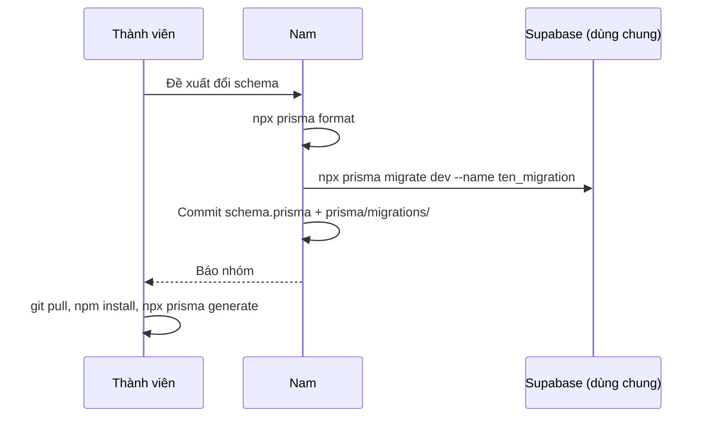

# RoadStudy — Hướng dẫn cài đặt và vận hành

RoadStudy gồm ba thành phần, chạy trực tiếp bằng Node.js hoặc bằng Docker Compose:

| Thành phần  | Công nghệ                           | URL                      |
| ----------- | ----------------------------------- | ------------------------ |
| Database    | PostgreSQL (Supabase) + Prisma 6    | _(chuỗi `DATABASE_URL`)_ |
| Backend API | Node.js 24 + Express 5 (CommonJS)   | `http://localhost:5000`  |
| Frontend    | React 19 + Vite (JSX) + Tailwind v4 | `http://localhost:5173`  |

## Mục lục

1. [Yêu cầu môi trường](#1-yêu-cầu-môi-trường)
2. [Cài đặt dependencies](#2-cài-đặt-dependencies)
3. [Biến môi trường](#3-biến-môi-trường)
4. [PostgreSQL và Prisma](#4-postgresql-và-prisma)
5. [Chạy frontend và backend](#5-chạy-frontend-và-backend)
6. [Docker và Docker Compose](#6-docker-và-docker-compose)
7. [Database migration](#7-database-migration)
8. [Kiểm thử](#8-kiểm-thử)
9. [Tài liệu API (Swagger)](#9-tài-liệu-api-swagger)
10. [Xử lý lỗi thường gặp](#10-xử-lý-lỗi-thường-gặp)
11. [Cấu trúc và tài liệu dự án](#11-cấu-trúc-và-tài-liệu-dự-án)

## 1. Yêu cầu môi trường

| Công cụ        | Kiểm tra                 | Ghi chú                                        |
| -------------- | ------------------------ | ---------------------------------------------- |
| Git            | `git --version`          |                                                |
| Node.js        | `node --version`         | Nhóm dùng v24.x                                |
| npm            | `npm --version`          | Dùng `package-lock.json`, không dùng pnpm/yarn |
| Docker Desktop | `docker compose version` | Tùy chọn, chỉ khi chạy bằng Docker             |

Database nằm trên Supabase, **không cần** cài PostgreSQL trên máy. Hỏi Nam để được cấp chuỗi kết nối.

## 2. Cài đặt dependencies

```bash
git clone <repo-url>
cd RoadStudy

npm install                      # thư mục gốc: chỉ có Prettier để format Markdown
cd BE_RStudy && npm install      # backend (postinstall tự chạy prisma skills sync)
cd ../FE_RStudy && npm install   # frontend
```

Hai project `BE_RStudy/` và `FE_RStudy/` độc lập, không có npm workspace.

## 3. Biến môi trường

```bash
cp BE_RStudy/.env.example BE_RStudy/.env
cp FE_RStudy/.env.example FE_RStudy/.env
```

### Backend (`BE_RStudy/.env`)

| Nhóm       | Biến                                                                                                          | Ghi chú                                                                                                                                                                                                                                                                                                                                                                                           |
| ---------- | ------------------------------------------------------------------------------------------------------------- | ------------------------------------------------------------------------------------------------------------------------------------------------------------------------------------------------------------------------------------------------------------------------------------------------------------------------------------------------------------------------------------------------- |
| Server     | `PORT`, `NODE_ENV`                                                                                            | Mặc định cổng 5000                                                                                                                                                                                                                                                                                                                                                                                |
| Redis      | `REDIS_URL`, `REDIS_KEY_ENV`, `REDIS_CONNECT_TIMEOUT_MS`, `REDIS_COMMAND_TIMEOUT_MS`                          | Tùy chọn. `REDIS_URL` trống = tắt Redis, hệ thống chạy như cũ. Có Redis: `docker compose --profile redis up -d redis` (đặt `REDIS_PASSWORD`), rồi đặt `REDIS_URL=redis://:<mật khẩu>@redis:6379` khi backend chạy trong Docker hoặc `redis://:<mật khẩu>@localhost:6379` khi chạy ngoài. Container Redis không publish cổng. Redis lỗi thì hệ thống vẫn chạy, `/health/ready` báo `redis: "down"` |
| Cache      | `CACHE_TTL_SECONDS`                                                                                           | Thời gian giữ cache 4 API công khai (mặc định 60 giây). Chỉ có tác dụng khi bật Redis                                                                                                                                                                                                                                                                                                             |
| Swagger    | `SWAGGER_ENABLED`                                                                                             | Để trống: bật `/api-docs` khi dev, tắt khi `NODE_ENV=production`. `true` hoặc `false` để ép bật hoặc tắt                                                                                                                                                                                                                                                                                          |
| Pool DB    | `DB_CONNECTION_LIMIT`, `DB_POOL_TIMEOUT`                                                                      | Số kết nối tối đa tới DB và số giây chờ kết nối. Để trống = mặc định Prisma (thường 9 kết nối, chỉ khoảng 10 request/giây vì mỗi truy vấn tới Supabase mất ~165ms). Đã đo: 30 kết nối cho khoảng 33 request/giây. Chỉ tăng khi `DATABASE_URL` là pooler chế độ transaction (cổng 6543, `pgbouncer=true`)                                                                                          |
| CORS       | `CORS_ORIGIN`                                                                                                 | Origin FE được gọi API, ngăn cách bằng dấu phẩy. Mặc định `http://localhost:5173`. FE chạy ở địa chỉ khác (ví dụ `127.0.0.1:5173`, domain thật) thì phải thêm vào                                                                                                                                                                                                                                 |
| Proxy      | `TRUST_PROXY`                                                                                                 | Số lớp reverse proxy phía trước backend, mặc định 0. Đặt 1 khi chạy sau nginx để giới hạn tần suất lấy đúng IP; để sai thì client giả được IP                                                                                                                                                                                                                                                     |
| Database   | `DATABASE_URL`, `DIRECT_URL`                                                                                  | App dùng chuỗi qua pooler; Prisma CLI dùng chuỗi trực tiếp. Nam cấp                                                                                                                                                                                                                                                                                                                               |
| JWT        | `JWT_ACCESS_SECRET`, `JWT_ACCESS_EXPIRES`, `JWT_REFRESH_SECRET`, `JWT_REFRESH_EXPIRES`                        | Access 15 phút, refresh 7 ngày                                                                                                                                                                                                                                                                                                                                                                    |
| OTP        | `OTP_EXPIRES_MINUTES`                                                                                         | Mặc định 10                                                                                                                                                                                                                                                                                                                                                                                       |
| Lưu file   | `STORAGE_DRIVER`, `CLOUDINARY_CLOUD_NAME`, `CLOUDINARY_API_KEY`, `CLOUDINARY_API_SECRET`, `CLOUDINARY_FOLDER` | `local` (mặc định, thư mục `uploads`) hoặc `cloudinary`. Cloudinary cần cả 3 biến, thiếu thì server không khởi động. Cloudinary: bật "Allow delivery of PDF and ZIP files" ở Settings → Security để mở được tài liệu PDF                                                                                                                                                                          |
| Mail       | `SMTP_HOST`, `SMTP_PORT`, `SMTP_USER`, `SMTP_PASS`, `MAIL_FROM`                                               | Gmail + app password để gửi OTP                                                                                                                                                                                                                                                                                                                                                                   |
| Thanh toán | `PAYMENT_BANK_ID`, `PAYMENT_ACCOUNT_NO`, `PAYMENT_ACCOUNT_NAME`                                               | Thông tin nhận chuyển khoản, tạo mã VietQR                                                                                                                                                                                                                                                                                                                                                        |
| AI         | `AI_PROVIDER`, `GEMINI_API_KEY`, `GEMINI_MODEL`, `AI_API_KEY`, `AI_BASE_URL`, `AI_MODEL`, `AI_TIMEOUT_MS`     | `gemini` dùng `GEMINI_*`; `openai` dùng `AI_*` (mặc định Groq). Timeout mặc định 20000ms                                                                                                                                                                                                                                                                                                          |

### Frontend (`FE_RStudy/.env`)

```dotenv
VITE_API_URL=http://localhost:5000/api
VITE_ASSET_URL=http://localhost:5000
```

> **Không commit `.env`** và **không dán nội dung `.env`, `DATABASE_URL`, `DIRECT_URL` vào chat hay tài liệu.** Các file này đã được `.gitignore` bỏ qua; chỉ commit `.env.example` với giá trị giữ chỗ.

## 4. PostgreSQL và Prisma

- Cả nhóm dùng chung **một project Supabase**. Database đã được Nam migrate và seed sẵn.
- App kết nối bằng `DATABASE_URL`. Prisma CLI (`migrate`, `db seed`) đọc `BE_RStudy/prisma.config.ts` và dùng `DIRECT_URL`.
- Sau khi cài lần đầu hoặc sau mỗi lần pull:

  ```bash
  cd BE_RStudy
  npx prisma generate          # hoặc npm run db:generate
  npx prisma migrate status    # kiểm tra DB chung đã đủ migration
  ```

- **Không** chạy `npx prisma migrate dev`, `npx prisma db seed` hay `npx prisma migrate reset`: các lệnh này ghi đè hoặc xóa dữ liệu của cả nhóm. Cần reset thì báo Nam.

### Tài khoản mẫu

Mật khẩu chung `Password123!` (chỉ dùng khi phát triển, đổi trước khi demo). Khi gõ `!` trong Git Bash, chạy `set +H` trước.

| Vai trò              | Email                  |
| -------------------- | ---------------------- |
| Quản trị viên trưởng | `leader@roadstudy.vn`  |
| Quản trị viên thường | `admin@roadstudy.vn`   |
| Giáo viên (đã duyệt) | `teacher@roadstudy.vn` |
| Học viên             | `student@roadstudy.vn` |

## 5. Chạy frontend và backend

Mở hai terminal:

```bash
cd BE_RStudy && npm run dev    # nodemon src/app.js, cổng 5000
cd FE_RStudy && npm run dev    # Vite, cổng 5173
```

| URL                                  | Mô tả                                                  |
| ------------------------------------ | ------------------------------------------------------ |
| `http://localhost:5173`              | Frontend                                               |
| `http://localhost:5000/api`          | Gốc của Backend API                                    |
| `http://localhost:5000/health`       | Kiểm tra Backend sống                                  |
| `http://localhost:5000/health/ready` | Backend sống và kết nối được database (503 nếu DB lỗi) |
| `http://localhost:5000/api-docs`     | Swagger UI: xem và thử API (chỉ khi dev)               |
| `http://localhost:5000/uploads/...`  | File tĩnh (`avatars`, `covers`, `resources`)           |

Ảnh minh chứng thanh toán **không** được phục vụ công khai (thư mục `uploads/proofs` hoặc Cloudinary `type: authenticated`), chỉ truy cập qua API có kiểm tra quyền. Khi `STORAGE_DRIVER=cloudinary`, ảnh và tài liệu mới là URL `https://res.cloudinary.com/...`; thư mục `/uploads/...` chỉ còn phục vụ file local cũ.

Lệnh khác: `npm start` (BE, không hot reload), `npm run build` / `npm run preview` / `npm run lint` (FE), `npm run db:studio` (BE, mở Prisma Studio).

Dừng: `Ctrl + C` ở từng terminal.

## 6. Docker và Docker Compose

Cần Docker Desktop đang chạy và `BE_RStudy/.env` đã điền đủ (không cần `npm install`, không cần `.env` của FE). Ở thư mục gốc:

```bash
docker compose up -d --build    # build và chạy nền backend + frontend
docker compose logs -f backend  # xem log backend
docker compose down             # dừng và xóa container
```

| Service    | Image                              | Cổng          | Ghi chú                                                                                                                  |
| ---------- | ---------------------------------- | ------------- | ------------------------------------------------------------------------------------------------------------------------ |
| `backend`  | `BE_RStudy/Dockerfile`             | `5000:5000`   | Đọc `BE_RStudy/.env`, gắn `BE_RStudy/uploads` vào `/app/uploads`. Chạy bằng user `node`, healthcheck gọi `/health/ready` |
| `redis`    | `redis:7-alpine` (profile `redis`) | không publish | Tùy chọn, chỉ chạy khi có `--profile redis`. Cần `REDIS_PASSWORD`. Giới hạn 128MB, không ghi đĩa                         |
| `frontend` | `FE_RStudy/Dockerfile` + nginx     | `5173:80`     | `VITE_*` nhúng lúc build qua `frontend.build.args`                                                                       |

- Cùng cổng với cách chạy thường, nên tắt `npm run dev` trước.
- Container backend vẫn kết nối database Supabase dùng chung, không có Postgres riêng.
- Container chạy bằng user `node` (không phải root). Trên Linux, thư mục `BE_RStudy/uploads` phải ghi được bởi uid 1000 (`chown 1000:1000 BE_RStudy/uploads`), nếu không upload sẽ lỗi.
- Đây là bản build như production: sửa code xong phải chạy lại `docker compose up -d --build`. Khi đang code nên dùng `npm run dev`.

## 7. Database migration

**Chỉ Nam sửa `prisma/schema.prisma` và chạy migration.** Người khác cần đổi bảng hoặc cột thì báo Nam.



Thành viên sau khi pull chỉ cần `npx prisma generate`; migration đã được áp lên DB chung. Kiểm tra bằng `npx prisma migrate status`.

## 8. Kiểm thử

| Vùng     | Lệnh                             | Ghi chú                                              |
| -------- | -------------------------------- | ---------------------------------------------------- |
| Backend  | `node tests/<module>.test.js`    | Cần `npm run dev` đang chạy và DB thật; in PASS/FAIL |
| AI       | `node tests/ai-check.js`         | Kiểm tra kết nối nhà cung cấp AI                     |
| Frontend | `npm run lint`, `npm run build`  | Chưa có test tự động                                 |
| Markdown | `npx prettier --check <file.md>` | Chạy ở thư mục gốc                                   |

- `npm test` của backend chỉ là stub.
- `tests/helpers/auth.js` tạo access token hợp lệ, không cần đăng nhập qua OTP.
- Các test `category`, `comment`, `course`, `course.public` còn gửi header `x-dev-role` đã bỏ, nên một số route cần đăng nhập trong các file này có thể FAIL.

## 9. Tài liệu API (Swagger)

Swagger UI ở `http://localhost:5000/api-docs` (file OpenAPI: `/api-docs.json`), mặc định chỉ bật khi dev. Tài liệu **sinh tự động** từ route, validator và `api-spec.md`, nên không có bản riêng để sửa. Bấm **Authorize**, dán `accessToken` (không cần chữ `Bearer`) để thử API cần đăng nhập. Image Docker không chép thư mục `docs/` nên nếu bật Swagger trong container thì thiếu phần mô tả.

Nguồn chuẩn về endpoint là [`BE_RStudy/docs/api-spec.md`](BE_RStudy/docs/api-spec.md) (mục 21 là bảng trạng thái tài liệu theo module). Giá trị enum và trạng thái ở [`BE_RStudy/docs/enum.md`](BE_RStudy/docs/enum.md).

Thử API thủ công (hoặc trong Swagger): gọi `POST /api/auth/login`, lấy `accessToken`, gửi kèm header `Authorization: Bearer <accessToken>` (token sống 15 phút, làm mới bằng `POST /api/auth/refresh`).

## 10. Xử lý lỗi thường gặp

| Hiện tượng                                            | Nguyên nhân thường gặp                    | Cách xử lý                                                           |
| ----------------------------------------------------- | ----------------------------------------- | -------------------------------------------------------------------- |
| `prisma migrate`/`db seed` báo thiếu `DIRECT_URL`     | `.env` cũ chưa có biến này                | Thêm `DIRECT_URL` (hỏi Nam)                                          |
| `@prisma/client did not initialize yet`               | Chưa sinh Prisma Client sau khi pull      | `npx prisma generate`                                                |
| Backend báo `EADDRINUSE :5000` / FE báo cổng 5173 bận | Đang chạy cả `npm run dev` và Docker      | Tắt một bên (`docker compose down` hoặc `Ctrl + C`)                  |
| FE gọi API lỗi CORS hoặc `Network Error`              | Backend chưa chạy hoặc sai `VITE_API_URL` | Mở `/health`, kiểm tra `FE_RStudy/.env`, khởi động lại `npm run dev` |
| Ảnh avatar/bìa không hiện                             | Sai `VITE_ASSET_URL`                      | Đặt `VITE_ASSET_URL=http://localhost:5000`                           |
| Đăng nhập giáo viên trả 403                           | Giáo viên chưa được duyệt hoặc bị từ chối | Dùng tài khoản admin duyệt giáo viên                                 |
| Không nhận được mã OTP                                | Sai cấu hình SMTP                         | Kiểm tra `SMTP_*`, dùng app password của Gmail                       |
| Chatbot luôn trả câu dự phòng                         | Sai khóa hoặc nhà cung cấp AI             | `node tests/ai-check.js`, kiểm tra `AI_PROVIDER` và khóa tương ứng   |
| Git Bash báo `event not found` khi gõ mật khẩu        | Bash diễn giải ký tự `!`                  | Chạy `set +H` trước                                                  |
| Docker FE vẫn gọi API cũ sau khi đổi `VITE_*`         | Biến nhúng lúc build                      | Sửa `docker-compose.yml` rồi `docker compose up -d --build`          |

## 11. Cấu trúc và tài liệu dự án

```text
RoadStudy/
├── CLAUDE.md               # Điều phối cho Claude Code
├── PRODUCT.md              # Mục tiêu sản phẩm, người dùng, phạm vi
├── DESIGN_SYSTEM.md        # Design system chính thức (token + quy tắc)
├── SETUP.md                # Tài liệu này
├── docker-compose.yml
├── .claude/
│   ├── settings.json       # Cấu hình Claude Code dùng chung (permissions, hooks)
│   ├── rules/              # Quy ước kỹ thuật, nghiệp vụ, quy trình (đọc được như tài liệu)
│   └── agents/             # Subagent review và test (frontend, backend, security, test-engineer)
├── BE_RStudy/
│   ├── docs/               # api-spec.md, enum.md
│   ├── prisma/             # schema.prisma, migrations/, seed.js
│   ├── src/                # app.js, config, constants, middlewares, utils, routes|controllers|services|repositories|validators
│   ├── tests/              # Script test gọi HTTP
│   └── uploads/            # avatars, covers, resources, proofs (không commit)
└── FE_RStudy/
    └── src/                # api, components, constants, context, hooks, pages, routes, utils
```

| Muốn biết                            | Đọc                                                                                                              |
| ------------------------------------ | ---------------------------------------------------------------------------------------------------------------- |
| Quy trình Git, PR, việc cần xin phép | [`.claude/rules/workflow.md`](.claude/rules/workflow.md)                                                         |
| Quy ước backend / frontend           | [`.claude/rules/backend.md`](.claude/rules/backend.md), [`.claude/rules/frontend.md`](.claude/rules/frontend.md) |
| Database, migration                  | [`.claude/rules/database.md`](.claude/rules/database.md)                                                         |
| Phân quyền, dữ liệu nhạy cảm         | [`.claude/rules/security.md`](.claude/rules/security.md)                                                         |
| Quy tắc nghiệp vụ                    | [`.claude/rules/business.md`](.claude/rules/business.md)                                                         |
| Kiểm thử                             | [`.claude/rules/testing.md`](.claude/rules/testing.md)                                                           |
| Giao diện                            | [`DESIGN_SYSTEM.md`](DESIGN_SYSTEM.md)                                                                           |

### Claude Code

- `.claude/settings.json` dùng chung cho cả nhóm: cho phép sẵn lệnh chỉ đọc (lint, build, `prisma validate`, `graphify query`), luôn hỏi trước khi cài package, migrate, seed, commit, push, đổi nhánh hay đọc `.env`, chặn `prisma migrate reset` và force push.
- Cấu hình riêng từng máy đặt ở `.claude/settings.local.json` (đã được `.gitignore` bỏ qua).
- Hook graphify chỉ chạy khi máy có lệnh `graphify` (gói Python `graphifyy`, ví dụ `uv tool install graphifyy`); không có thì hook tự bỏ qua.
